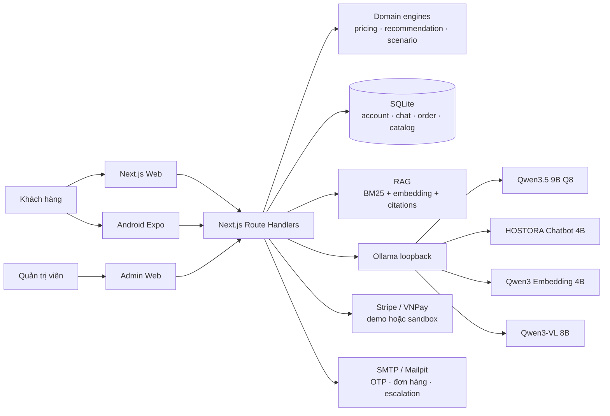

# HOSTORA AI

> Nền tảng tư vấn và vận hành website local-first dành cho chủ shop, doanh nghiệp
> nhỏ và người không rành kỹ thuật — từ một nhu cầu còn mơ hồ đến website mẫu,
> phương án hosting có nguồn, yêu cầu mua và hỗ trợ sau bán hàng.

**Một repository · Ba bề mặt sản phẩm · Một backend dùng chung · AI chạy local**

HOSTORA AI không phải một landing page gắn thêm ô chat. Đây là một sản phẩm
full-stack hoàn chỉnh gồm website khách hàng, ứng dụng Android, web quản trị,
backend giao dịch, hệ thống RAG, các workflow AI có kiểm soát, bộ dữ liệu thương
mại có nguồn và quy trình kiểm thử/bàn giao có thể tái lập.

## Mục lục

- [Tổng quan và bài toán](#tổng-quan-dự-án)
- [Web, Android và web quản trị](#những-gì-đã-xây-dựng)
- [AI, RAG, guardrail và fine-tuning](#hệ-thống-ai-đã-triển-khai)
- [Kiến trúc và công nghệ](#kiến-trúc-tổng-thể)
- [Link demo, APK và Source ZIP](#truy-cập-nhanh)
- [Chạy bằng Docker cho người mới](#hướng-dẫn-cho-người-chưa-biết-code--chạy-bằng-docker)
- [Chạy development và Android](#chạy-local-cho-lập-trình-viên)
- [Kiểm thử và hồ sơ vòng loại](#kiểm-thử-và-minh-chứng)

## Tổng quan dự án

### Bài toán HOSTORA giải quyết

Người mới làm website thường biết mình muốn “bán hàng”, “giới thiệu công ty”
hoặc “làm web cho đẹp”, nhưng chưa biết cần tên miền, hosting, SSL, email, sao
lưu hay mức tài nguyên nào. Giá ưu đãi theo tháng cũng dễ bị hiểu nhầm thành số
tiền phải trả từng tháng, trong khi kỳ thanh toán, giá gia hạn và dịch vụ đi kèm
có thể thay đổi đáng kể.

Một chatbot thuần LLM không đủ an toàn cho bài toán này: model có thể bịa giá,
xếp sai gói, hứa SEO hoặc chịu tải không có căn cứ. HOSTORA vì vậy tách hệ thống
thành hai lớp:

- **AI hiểu và giải thích:** đọc nhu cầu tiếng Việt, truy xuất nguồn, soạn nội
  dung website và diễn giải kết quả bằng ngôn ngữ dễ hiểu;
- **Code quyết định:** TypeScript và SQLite kiểm soát giá, ngân sách, thứ tự gói,
  voucher, hóa đơn, thanh toán, hoàn tiền và trạng thái hội thoại.

Kết quả là một luồng xuyên suốt: **kể nhu cầu → kiểm tra AI hiểu gì → so sánh
phương án → dựng website mẫu → gửi yêu cầu mua → theo dõi đơn → nhận hỗ trợ**.

### Dữ liệu sản phẩm đã chuẩn hóa

- 29 dịch vụ từ 9 nhà cung cấp: hosting, WordPress, cloud, VPS, tên miền, SSL,
  email, workspace, backup, monitoring, CDN/security và automation;
- 13 gói hosting có thông số, giá ưu đãi, kỳ thanh toán, giá gia hạn khi có,
  giới hạn, URL nguồn và ngày xác minh;
- 36 tài liệu knowledge có metadata nguồn, thẩm quyền, chủ đề và ngày kiểm tra;
- dữ liệu chưa đủ được giữ là `null` hoặc hiển thị **Chưa xác minh**, không cho
  model tự điền phần còn thiếu.

## Những gì đã xây dựng

| Bề mặt                 | Chức năng chính                                                                                                                                                                             | Điểm kỹ thuật nổi bật                                                                                                        |
| ---------------------- | ------------------------------------------------------------------------------------------------------------------------------------------------------------------------------------------- | ---------------------------------------------------------------------------------------------------------------------------- |
| **Website khách hàng** | Catalog dịch vụ, wizard tư vấn, so sánh top 3, tồn kho theo gói, trợ lý AI có nguồn, gợi ý tên miền, Website Studio, launch readiness, chấm SEO/AI visibility, tài khoản, voucher, yêu cầu mua và tra cứu đơn | Next.js App Router, Server Components, structured metadata, JSON-LD, sitemap, `llms.txt`, responsive desktop/mobile          |
| **Ứng dụng Android**   | Trang chủ, danh mục, chọn gói, chat AI nhớ hồ sơ/đơn/website, checkout ngay trong chat, tồn kho, Website Studio, SEO analyzer, tài khoản, đơn hàng và hồ sơ giám khảo                              | Expo Router, React Native, cinematic cold-start 12,4 giây, Skia shader, Reanimated, haptic, SecureStore, APK universal 4 ABI |
| **Web quản trị**       | Dashboard donut/doanh thu/bar/treemap, kiểm soát số suất từng gói, catalog CRUD, hộp thư AI, yêu cầu mua, tạo hóa đơn, đối soát, hủy và hoàn tiền                                               | OTP email, session HMAC, Recharts, dự báo số học tất định, phân quyền route và dữ liệu SQLite                                |
| **Backend dùng chung** | AI/RAG, account memory, ingestion nguồn riêng, catalog, tồn kho, thanh toán, email, analytics và Website Studio                                                                             | Route handlers TypeScript, Zod, Node SQLite, giao dịch tồn kho idempotent, Ollama loopback, Stripe/VNPay sandbox, Nodemailer |

### Luồng trải nghiệm end-to-end

1. Khách mô tả nhu cầu tự nhiên hoặc điền wizard bốn bước.
2. Qwen trích xuất dữ kiện có cấu trúc; Zod từ chối output sai schema.
3. Engine tất định lọc catalog và tồn kho, tính tiền trả trước, kiểm tra ngân
   sách rồi xếp tối đa ba phương án.
4. Trợ lý giải thích bằng tiếng Việt, đính nguồn và nêu rõ điều chưa xác minh.
5. Khách có thể dùng Website Studio để tạo bản xem trước và tải website mẫu.
6. Khách chọn gói ngay trong đề xuất hoặc hội thoại, tạo hóa đơn và thanh toán
   demo/sandbox không bị đẩy về danh mục. Chỉ thanh toán thành công mới trừ một
   suất; hoàn tiền hoàn tất trả lại suất và mỗi giao dịch được chống ghi hai lần.
7. Trợ lý tiếp tục giải thích phần có căn cứ khi câu hỏi khó hoặc thiếu dữ kiện;
   với tài khoản đã đăng nhập, trợ lý đọc website Studio, hồ sơ đã gửi và trạng
   thái đơn hiện tại để tư vấn tiếp, phân biệt yêu cầu mới với gói đã thanh toán;
   dữ liệu thời gian thực như trạng thái tên miền được hướng dẫn kiểm tra lại.
   Khi khách yêu cầu người thật, câu hỏi thực sự ngoài phạm vi hoặc AI local
   gián đoạn, hội thoại được chuyển vào inbox admin và có thể phát email thông báo.

## Hệ thống AI đã triển khai

### Model và vai trò

| Thành phần     | Model/runtime                       | Vai trò và trạng thái                                                                                               |
| -------------- | ----------------------------------- | ------------------------------------------------------------------------------------------------------------------- |
| Structured AI  | `qwen3.5:9b-q8_0` qua Ollama        | Trích xuất nhu cầu, giải thích, phân tích readiness và các output JSON có schema; đang dùng trong runtime local     |
| Chatbot RAG    | `hostora-chatbot:4b-q8-20261023-v2` | Model Qwen3.5-4B LoRA/GGUF Q8 đang dùng cho hội thoại trong môi trường demo đã kiểm tra                             |
| Embedding      | `qwen3-embedding:4b`                | Vector 2.560 chiều cho knowledge RAG; có lexical fallback khi embedding/index không sẵn sàng                        |
| Vision         | `qwen3-vl:8b`                       | Được cấu hình để đọc ảnh hành trình/ảnh nguồn riêng; output bị giới hạn schema và không được đoán chữ không nhìn rõ |
| Website Studio | Qwen structured output + LangGraph  | Viết nội dung, kiểm tra claim không có nguồn, tự sửa một lượt rồi chuyển sang template fallback nếu vẫn không đạt   |
| Runtime        | Ollama `127.0.0.1:11434`            | Context thực tế 16.384 token, `keep_alive=10m`, không có cloud AI fallback                                          |

LangGraph hiện điều phối **Website Studio**. Luồng chatbot dùng phân nhánh bảo vệ,
bộ nhớ nhu cầu, RAG, catalog và Ollama trực tiếp; không gắn nhãn chatbot là
LangGraph khi chưa có graph cho hội thoại. Câu trả lời trên web và Android chỉ
hiện số tham chiếu như `[1]`; danh sách tài liệu và liên kết nằm ngay dưới câu
trả lời.

### RAG: dữ kiện mới không cần nhồi vào trọng số model

```text
Câu hỏi tiếng Việt
      │
      ├─ che PII + kiểm tra input
      │
      ├─ query expansion tất định
      │
      ├─ BM25 lexical + Qwen embedding/cosine
      │       └─ đa dạng hóa URL và chủ đề
      │
      ├─ catalog + plan + knowledge có nguồn
      │
      └─ prompt coi context là dữ liệu không tin cậy
              └─ Qwen trả lời → lọc citation giả → lưu bản đã che PII
```

RAG chính dùng 36 tài liệu trong `data/knowledge.json` và index local trong
`data/rag-index.json`. Bộ đánh giá nội bộ 10 câu high-signal đạt Recall@5 = 1,00
và MRR@5 = 0,95 tại snapshot 23/10/2026. Đây là chỉ số retrieval nội bộ, không
được diễn giải thành độ chính xác tuyệt đối của câu trả lời hoặc hiệu quả kinh
doanh.

Tài khoản còn có thể thêm nguồn riêng dạng PDF, DOCX, TXT/Markdown, website công
khai hoặc ảnh. Server giới hạn dung lượng/trang, chặn URL nội bộ để giảm SSRF,
che thông tin liên hệ, cắt đoạn và dùng BM25 lấy tối đa bốn đoạn liên quan.
Nguồn riêng chỉ giúp hiểu doanh nghiệp và sản phẩm của khách; nó không được dùng
để thay thế dữ liệu giá/availability chính thức.

### Guardrail và kiểm soát đầu ra

- mọi structured output đi qua Zod và JSON Schema;
- context RAG, website và ảnh được xem là dữ liệu không tin cậy; chỉ dẫn/prompt
  injection nằm trong nguồn bị bỏ qua;
- email, số điện thoại, OTP, token và chuỗi giống bí mật được che trước khi đưa
  vào model hoặc lưu lịch sử;
- citation chỉ được tạo từ metadata retrieval, không nhận citation ID model tự
  bịa;
- giá, xếp hạng, voucher, doanh thu, forecast và trạng thái thanh toán do code
  tất định quyết định;
- model không có shell, filesystem, database mutation hoặc network tool tùy ý;
- chuyển quản trị viên khi khách yêu cầu người thật, câu hỏi ngoài phạm vi hoặc
  trợ lý không sẵn sàng; thiếu giá/dữ kiện riêng chưa xác minh được giải thích
  và hỏi tiếp trong cuộc chat;
- hội thoại được lưu để admin tiếp tục trả lời, nhưng log AI chỉ ghi model,
  latency, token usage và feature — không ghi nguyên văn prompt hoặc PII.

### Fine-tuning và artifact có thể kiểm tra

Runtime hiện tại và adapter mới được tách rõ để không quảng bá nhầm candidate
thành production:

| Adapter      | Base model           | Dữ liệu/huấn luyện                                                  | Artifact và trạng thái                                                                                                                                       |
| ------------ | -------------------- | ------------------------------------------------------------------- | ------------------------------------------------------------------------------------------------------------------------------------------------------------ |
| `chatbot-v8` | `unsloth/Qwen3.5-4B` | 737 dòng, 8 epoch, 1.480 step, BF16 LoRA; adapter reload thành công | Có adapter `.safetensors`, tokenizer, config, dataset manifest, evaluation và hash; `promotion.json` vẫn là **candidate**, gate chưa đạt và không tự promote |
| `studio-v3`  | `unsloth/Qwen3.5-4B` | 384 dòng, 6 epoch, 768 step, BF16 LoRA; adapter reload thành công   | Có cùng bộ artifact và evaluation; gate offline đạt nhưng vẫn là **candidate** chờ human review, không tự promote                                            |

Gói fine-tuning không chứa base model 4,6 GB; người kiểm tra tải base model theo
tài liệu rồi gắn LoRA adapter. Việc có training loss hoặc reload thành công
không được dùng thay cho benchmark độc lập với dữ liệu khách hàng thật.

## Kiến trúc tổng thể



Các ranh giới quan trọng trong source:

- `app/api/ai/*`: trích xuất, giải thích, hội thoại, retrieval và Studio;
- `lib/recommendation.ts`, `lib/pricing.ts`, `lib/scenario.ts`: quyết định số học;
- `lib/site-studio-workflow.ts`: graph `write_copy → recommend_hosting` và
  template fallback;
- `lib/customer-ai-sources.ts`: PDF/DOCX/text/web/image ingestion;
- `data/hosting-catalog.ts`, `data/product-catalog.ts`: catalog có nguồn;
- `data/knowledge.json`, `data/rag-index.json`: knowledge và embedding index;
- `lib/customer/store.ts`, `lib/payments/store.ts`: SQLite runtime;
- `mobile/`: ứng dụng Expo/React Native dùng chung backend.

Xem thêm [sơ đồ hệ thống](docs/architecture/hostora-system.html),
[luồng sản phẩm](docs/architecture/hostora-product-flow.html),
[luồng RAG](docs/architecture/hostora-rag-flow.html) và
[luồng Website Studio](docs/architecture/hostora-site-studio-flow.html).

## Công nghệ sử dụng

| Nhóm                | Công nghệ                                                                                | Ứng dụng trong HOSTORA                                               |
| ------------------- | ---------------------------------------------------------------------------------------- | -------------------------------------------------------------------- |
| Web full-stack      | Next.js 16.4.2, React 19.3.1, TypeScript 6.0.3, App Router, Tailwind CSS 4               | Website, admin, API, SEO metadata, standalone server                 |
| Android             | Expo 58, React Native 0.88, Expo Router, Reanimated 4, Skia 2, AsyncStorage, SecureStore | Native navigation, animation, shader, persistence, auth và APK       |
| AI/ML               | Ollama 0.34.3, Qwen3.5, Qwen3 Embedding, Qwen3-VL, LoRA, GGUF Q8, LangGraph              | Structured extraction, chat, RAG, vision và Website Studio workflow  |
| Data                | Node SQLite, JSON knowledge/index, local filesystem runtime                              | Tài khoản, hội thoại, memory, catalog, đơn hàng, feedback và Studio  |
| Validation/security | Zod, HMAC session, Turnstile tùy chọn, SSRF guard, PII redaction                         | Schema, admin auth, input boundary và bảo vệ dữ liệu                 |
| Commerce/email      | Stripe SDK, VNPay HMAC, Nodemailer, Mailpit                                              | Checkout sandbox, webhook/IPN, đối soát, hoàn tiền, OTP và thông báo |
| Visualization       | Three.js, Motion, Recharts, React Native Skia, Reanimated, haptic                        | Brand world 3D, cinematic mobile và dashboard quản trị               |
| Testing             | Vitest, Playwright, axe-core, Maestro, Mobile MCP, ADB                                   | Unit/API, E2E desktop/mobile, accessibility và APK native            |
| DevOps/bàn giao     | Docker Compose, GitHub Actions, GitHub Releases/Pages, Tailscale Funnel                  | Chạy đa nền tảng, CI, artifact, báo cáo tĩnh và demo HTTPS           |

> Langfuse/OpenTelemetry đã có lớp tích hợp nhưng Langfuse mặc định tắt vì chưa
> có project/self-host instance được kiểm chứng end-to-end. README không tính
> dependency đã cài nhưng chưa hoạt động thành một thành tích production.

## Năng lực kỹ thuật dự án thể hiện

| Mảng                  | Phần đã thực hiện                                                                                                                    |
| --------------------- | ------------------------------------------------------------------------------------------------------------------------------------ |
| Product engineering   | Thiết kế hành trình từ tư vấn đến mua, thanh toán, hỗ trợ và vận hành thay vì làm các màn rời rạc                                    |
| Full-stack            | Xây website, admin, REST-like route handlers, auth, SQLite, email và payment lifecycle trong một codebase TypeScript                 |
| AI engineering        | Local inference, structured output, RAG hybrid, citation control, prompt-injection defense, model benchmark và LoRA artifact handoff |
| Mobile engineering    | Expo/React Native app, cinematic/animation, responsive native UI, backend profiles và APK universal giữ dữ liệu khi cập nhật         |
| Data/decision systems | Catalog có nguồn, scoring minh bạch, phân biệt giá ưu đãi/gia hạn/trả trước và graceful fallback khi AI lỗi                          |
| Quality engineering   | Unit/API, Playwright desktop/mobile, accessibility audit, Maestro/Mobile MCP, checksum và release parity                             |
| DevOps                | Docker đa nền tảng, standalone Next.js, GitHub Actions, Releases, Pages và public HTTPS tunnel                                       |

Không đánh đồng số framework với chất lượng sản phẩm: các con số kiểm thử bên
dưới là bằng chứng kỹ thuật theo từng phiên bản, không phải cam kết SLA hoặc bảo đảm
thứ hạng cuộc thi.

## Truy cập nhanh

| Nội dung                         | Liên kết                                                                                                                                   | Trạng thái                                                         |
| -------------------------------- | ------------------------------------------------------------------------------------------------------------------------------------------ | ------------------------------------------------------------------ |
| Web khách hàng                   | [Mở HOSTORA](https://admin123-system-product-name.tailfeea7a.ts.net:8443/)                                                                 | HTTPS cố định qua Tailscale Funnel, kiểm tra 07/11/2026            |
| Web quản trị                     | [Mở trang admin](https://admin123-system-product-name.tailfeea7a.ts.net:8443/admin)                                                        | Chuyển tới cổng đăng nhập admin                                    |
| Hộp thư AI của admin             | [Mở hộp thư hỗ trợ](https://admin123-system-product-name.tailfeea7a.ts.net:8443/admin/support)                                             | Cần phiên quản trị hợp lệ                                          |
| Chấm SEO + AI visibility         | [Mở công cụ kiểm tra](https://admin123-system-product-name.tailfeea7a.ts.net:8443/website-analyzer)                                        | Tách điểm Google, AI crawler và kế hoạch sửa tất định              |
| APK Android mới nhất             | [Tải HOSTORA AI 2.2.6 universal](https://github.com/minhnhatdepzai/HOSTORA-AI/releases/download/v2.2.6/HOSTORA-AI-2.2.6-universal.apk)     | Android 7.0+, 4 ABI, package `com.hostora.ai`                      |
| Link APK tương thích biểu mẫu cũ | [Tải qua tên `arm64.apk`](https://github.com/minhnhatdepzai/HOSTORA-AI/releases/download/v2.2.6/HOSTORA-AI-2.2.6-arm64.apk)                | Cùng binary universal; không phải bản chỉ có ARM64                 |
| SHA-256 APK                      | [Tải checksum](https://github.com/minhnhatdepzai/HOSTORA-AI/releases/download/v2.2.6/HOSTORA-AI-2.2.6-universal.apk.sha256)                | `91220925…41667c3f`; đối chiếu file checksum đầy đủ                |
| Web tĩnh “Kiểm thử”              | [Mở báo cáo 20 ca](https://minhnhatdepzai.github.io/HOSTORA-AI/)                                                                           | GitHub Pages tự deploy bằng GitHub Actions                         |
| Source ZIP mới nhất              | [Tải Source ZIP](https://github.com/minhnhatdepzai/HOSTORA-AI/releases/download/v2.2.6/HOSTORA-source-2.2.6-2026-11-07.zip)                | Web, admin, app, README, tài liệu, training source và cấu hình mẫu |
| Adapter fine-tuning              | [Tải gói fine-tuning 2.2.6](https://github.com/minhnhatdepzai/HOSTORA-AI/releases/download/v2.2.6/HOSTORA-finetuning-2.2.6-2026-11-07.zip) | Hai LoRA adapter candidate và bằng chứng; không nhân bản base model |
| Source                           | [GitHub repository](https://github.com/minhnhatdepzai/HOSTORA-AI)                                                                          | Nhánh `main`                                                       |

> URL `*.ts.net:8443` là hostname HTTPS cố định của Tailscale Funnel và không cần mua tên miền. HOSTORA production cùng Funnel tự chạy lại trên máy demo; máy tắt hoặc mất mạng thì website vẫn offline. Link APK trên GitHub Release hoạt động độc lập với máy demo.

## Trạng thái bản 2.2.6

- Source cuối: typecheck, lint, **350/350** unit/API test và production build đạt; Ollama local qua `pnpm ai:check` đạt với đúng model runtime.
- Browser production cách ly: **60 ca đạt, 2 ca mobile bỏ qua có chủ đích**; audit 12 tổ hợp desktop/mobile có 0 lỗi accessibility tự động và 0 page error.
- APK universal `versionCode 29`, 165.342.928 byte: đủ `arm64-v8a`, `armeabi-v7a`, `x86`, `x86_64`. Bản x86_64 đã cài đè lên Android Emulator 16 bằng `adb install -r`, giữ phiên, lịch sử và website.
- Native 2.2.6 đã kiểm tra trực tiếp: composer nằm trên bàn phím, không còn banner nổi toàn app, gợi ý hiển thị số suất, chatbot đọc hồ sơ/website/đơn, lịch sử chat còn nguyên và nút website mở đúng bản đã tạo trong Chrome.
- Admin live dùng cùng backend đã render donut tổng đơn, doanh thu 30 ngày, bar theo gói, treemap, bảng fallback và điều khiển tăng/giảm/đặt hết hàng; không có console error trong lượt kiểm tra 07/11/2026.

### Snapshot lịch sử 2.2.2

| Phần đã kiểm tra    | Kết quả gần nhất                                                                                                  |
| ------------------- | ----------------------------------------------------------------------------------------------------------------- |
| Web + admin         | Typecheck, lint và production build đạt                                                                           |
| Logic/API           | 309/309 test đạt                                                                                                  |
| AI local            | Ollama chat, Studio, embedding và smoke test chạy thật qua loopback; không dùng cloud fallback                    |
| E2E + UI audit      | 55 lượt đạt, 1 mobile CRUD bỏ qua có chủ đích; 12 màn audit không có lỗi axe/page/overflow tự động                |
| Android             | `com.hostora.ai` 2.2.2, versionCode 25; APK universal cài đè bằng `adb install -r` và giữ hội thoại trên emulator |
| Bộ giám khảo mobile | 20/20 kiểm tra showcase và TC01–TC09 đều đạt                                                                      |
| APK                 | 165.321.992 byte; đủ `arm64-v8a`, `armeabi-v7a`, `x86`, `x86_64`; SHA-256 như bảng trên                           |

Cinematic 12,4 giây phát ở mỗi cold-start và ghép đủ hai chương: orbit/beam/logo/headline, rồi H → HOSTORA → robot. Người dùng có thể bỏ qua hoặc phát lại từ Hồ sơ giám khảo; phát lại xong vẫn ở đúng màn đang mở. App giữ native splash, chuyển cảnh theo tiến độ, phản hồi chạm/haptic, Skia backdrop, sân khấu 3D và tôn trọng thiết lập Giảm chuyển động.

Trang **Chấm SEO + AI visibility** đọc tín hiệu công khai như metadata, sitemap, `robots.txt`, `llms.txt`, JSON-LD và quyền crawler của OpenAI/Anthropic/Perplexity. Điểm và việc ưu tiên do TypeScript tính tất định; Ollama local chỉ gợi ý ý tưởng nội dung và không thể nâng điểm. “Cho phép crawler” không đồng nghĩa ChatGPT hoặc Claude chắc chắn đề xuất website.

## Hướng dẫn cho người chưa biết code — chạy bằng Docker

Đây là cách dễ nhất để mở đầy đủ **web khách hàng, web admin, AI local và hộp
thư OTP** trên Windows, macOS hoặc Linux. Bạn không cần cài Node.js, pnpm,
Python hay Ollama riêng. Cần Internet trong lần chạy đầu để Docker tải image và
hai model AI; quá trình này có thể lâu và tốn nhiều GB tùy tốc độ mạng. Nên để
trống ít nhất 30 GB và dùng máy có từ 16 GB RAM; máy yếu hơn xem mục xử lý lỗi
bên dưới.

### Bước 1 — tải và giải nén Source ZIP

1. Tải [HOSTORA Source ZIP mới nhất](https://github.com/minhnhatdepzai/HOSTORA-AI/releases/download/v2.2.6/HOSTORA-source-2.2.6-2026-11-07.zip).
2. Windows: bấm chuột phải file ZIP → **Extract All / Giải nén tất cả**.
3. macOS: bấm đúp file ZIP. Linux: dùng trình quản lý file và chọn **Extract**.
4. Mở thư mục vừa giải nén. Đúng thư mục project sẽ nhìn thấy `README.md`,
   `compose.yaml`, thư mục `scripts` và thư mục `mobile`.

### Bước 2 — cài Docker

- Windows/macOS: cài [Docker Desktop](https://www.docker.com/products/docker-desktop/), mở ứng dụng và chờ trạng thái **Docker Engine is running**.
- Linux: cài Docker Engine và Docker Compose plugin theo hướng dẫn của Docker,
  rồi kiểm tra lệnh `docker compose version` chạy được.

Sau khi cài Docker Desktop, nếu Terminal hoặc PowerShell đang mở thì đóng và mở
lại một lần để hệ thống nhận lệnh `docker`.

### Bước 3A — chạy trên Windows

Trong File Explorer, mở đúng thư mục HOSTORA đã giải nén, bấm vào thanh địa chỉ,
gõ `powershell` rồi nhấn Enter. Dán lần lượt cả khối lệnh này:

```powershell
Copy-Item .env.docker.example .env.docker
$secret = ([guid]::NewGuid().ToString("N") + [guid]::NewGuid().ToString("N"))
(Get-Content .env.docker).Replace("replace-with-64-hex-characters", $secret) | Set-Content -Encoding ascii .env.docker
docker compose --env-file .env.docker up --build -d
docker compose --env-file .env.docker ps
```

Không đóng Docker Desktop trong lúc dùng HOSTORA. Lần đầu, `model-init` sẽ tải
`qwen3.5:9b-q8_0` và `qwen3-embedding:4b`; chưa thấy web ngay trong lúc tải là
bình thường.

### Bước 3B — chạy trên macOS hoặc Linux

Mở Terminal tại đúng thư mục HOSTORA đã giải nén rồi chạy:

```bash
chmod +x scripts/docker-up.sh scripts/docker-down.sh
./scripts/docker-up.sh
```

Script tự tạo `.env.docker` với secret ngẫu nhiên, build web, tải model và tạo
RAG index. Không chia sẻ file `.env.docker` lên Internet.

### Bước 4 — kiểm tra đã chạy thành công

Mở các địa chỉ sau trên chính máy đang chạy Docker:

| Cần mở            | Địa chỉ                            | Dấu hiệu đúng                |
| ----------------- | ---------------------------------- | ---------------------------- |
| Web khách hàng    | <http://127.0.0.1:3000>            | Hiện trang chủ HOSTORA       |
| Web admin         | <http://127.0.0.1:3000/admin>      | Hiện cổng đăng nhập quản trị |
| Hộp thư OTP local | <http://127.0.0.1:8025>            | Hiện giao diện Mailpit       |
| Kiểm tra backend  | <http://127.0.0.1:3000/api/health> | Trả về trạng thái JSON       |

Đăng nhập admin theo luồng demo:

1. Mở `/admin`, chọn **Gửi mã qua email**.
2. Mở Mailpit ở cổng `8025`.
3. Mở email HOSTORA mới nhất, lấy mã 6 số và nhập lại vào trang admin.

Kiểm tra container bằng lệnh sau. `model-init` hiện **Exited (0)** sau khi tải
xong là đúng, không phải lỗi; web và Ollama phải đang chạy/healthy.

```bash
docker compose --env-file .env.docker ps
```

### Lần sau mở máy, dừng và chạy lại

Docker lưu model, RAG, tài khoản demo, hội thoại và SQLite trong named volume,
vì vậy không phải tải lại mỗi lần. Sau khi khởi động máy, mở Docker Desktop rồi
chạy trong thư mục HOSTORA:

```bash
docker compose --env-file .env.docker start
```

Nếu `start` báo chưa có container, dùng lại:

```bash
docker compose --env-file .env.docker up --build -d
```

Dừng tạm thời mà vẫn giữ toàn bộ dữ liệu:

```bash
docker compose --env-file .env.docker stop
```

Không dùng `docker compose down -v` để dừng thông thường: tùy chọn `-v` xóa model
và toàn bộ dữ liệu runtime, khiến lần sau phải tải/tạo lại từ đầu.

### Kết nối app Android với backend Docker

1. Cài [APK universal 2.2.6](https://github.com/minhnhatdepzai/HOSTORA-AI/releases/download/v2.2.6/HOSTORA-AI-2.2.6-universal.apk).
2. Điện thoại thật cùng Wi-Fi: trong app mở **Công cụ → Kết nối local AI**, nhập
   `http://<IP-LAN-của-máy-tính>:3000`, lưu và kiểm tra kết nối.
3. Android Emulator trên cùng máy: nhập thủ công `http://10.0.2.2:3000`.

Nút preset **Máy ảo Android** trong app hiện dành cho dịch vụ production local
ở cổng `3200`; khi chạy Docker mặc định ở cổng `3000`, phải nhập URL emulator
thủ công như bước 3.

### Lỗi thường gặp

| Hiện tượng                           | Cách xử lý                                                                                                                                                     |
| ------------------------------------ | -------------------------------------------------------------------------------------------------------------------------------------------------------------- |
| `docker: command not found`          | Mở Docker Desktop, đóng rồi mở lại Terminal/PowerShell; kiểm tra `docker compose version`.                                                                     |
| Docker báo không kết nối được Engine | Chờ Docker Desktop báo Engine đang chạy; trên Windows kiểm tra WSL 2 đã bật.                                                                                   |
| Lần đầu chạy rất lâu                 | Xem tiến độ bằng `docker compose --env-file .env.docker logs -f model-init web`; chờ hai model tải xong.                                                       |
| Cổng `3000` đang được dùng           | Đổi `HOSTORA_PORT` và `HOSTORA_PUBLIC_BASE_URL` trong `.env.docker`, rồi chạy lại `up --build -d`.                                                             |
| Máy thiếu RAM/dung lượng             | Trong `.env.docker`, thử `HOSTORA_CHAT_MODEL=qwen3.5:4b-q4_K_M` và `HOSTORA_EMBED_MODEL=qwen3-embedding:0.6b`; phải kiểm tra lại chất lượng AI trước khi demo. |
| App Android không kết nối            | Mở URL backend bằng trình duyệt điện thoại trước; kiểm tra cùng Wi-Fi, firewall cổng 3000 và URL không dùng `127.0.0.1` trên điện thoại thật.                  |

Hướng dẫn kỹ thuật sâu hơn nằm tại [docs/DOCKER_DEPLOYMENT.md](docs/DOCKER_DEPLOYMENT.md).

## Chạy local cho lập trình viên

### Yêu cầu

- Node.js 22 trở lên;
- pnpm 12.15.0;
- Ollama chạy trên chính máy HOSTORA;
- khoảng trống phù hợp để tải model local.

### Cài và chạy development

```bash
git clone https://github.com/minhnhatdepzai/HOSTORA-AI.git
cd HOSTORA-AI
cp .env.example .env.local
corepack enable
pnpm install --frozen-lockfile
ollama pull qwen3.5:9b-q8_0
ollama pull qwen3-embedding:4b
ollama pull qwen3-vl:8b
pnpm rag:index
pnpm ai:check
pnpm dev
```

Mở <http://127.0.0.1:3000>. Các đường dẫn chính:

- `/` — website khách hàng;
- `/consultation` — tư vấn chọn gói;
- `/website-studio` — tạo website mẫu;
- `/admin` — web quản trị;
- `/api/health` — health check;
- `/downloads/android` — tải hoặc chuyển tới APK mới nhất.

### Chạy production

```bash
pnpm build
pnpm start
```

Server standalone dùng `PORT=3000` và `HOSTNAME=0.0.0.0` mặc định. Khi public ra Internet, đặt `HOSTORA_PUBLIC_BASE_URL` bằng origin HTTPS thật, dùng reverse proxy/WAF và cấu hình secret chỉ qua biến môi trường.

### Docker với NVIDIA GPU

Phần hướng dẫn Docker đầy đủ nằm ở trên. Máy đã có NVIDIA Container Toolkit có
thể dùng:

```bash
./scripts/docker-up.sh --gpu
```

Xem [hướng dẫn Docker](docs/DOCKER_DEPLOYMENT.md).

## Android

### Cài APK phát hành

Tải APK universal ở bảng “Truy cập nhanh”, sau đó mở trên điện thoại Android 7.0 trở lên hoặc cài bằng ADB. File chứa `arm64-v8a`, `armeabi-v7a`, `x86` và `x86_64`, vì vậy dùng được cho điện thoại ARM 32/64-bit và máy ảo Android tương ứng:

```bash
adb install -r HOSTORA-AI-2.2.6-universal.apk
```

`-r` cài đè và giữ dữ liệu app. Android 6 trở xuống không được Expo 58/React Native 0.88 hỗ trợ; cần một ứng dụng legacy riêng nếu buộc phải chạy trên các máy đó. APK 2.2.6 hiện dùng chữ ký debug cục bộ để chấm vòng loại, chưa phải bản ký production cho Google Play.

### Chạy app với backend qua USB

```bash
pnpm dev
adb reverse tcp:3000 tcp:3000
```

Trong app mở **Cài đặt → Kết nối local AI → USB localhost → Lưu và kiểm tra kết nối**.

### Chạy qua Wi-Fi/LAN

```bash
pnpm dev:lan
```

Trong app nhập `http://<IP-máy-HOSTORA>:3000`. Điện thoại và máy chủ phải cùng mạng; chỉ mở cổng 3000 trên mạng tin cậy.

### Build và cài lại APK

```bash
pnpm --dir mobile install --frozen-lockfile
pnpm --dir mobile typecheck
pnpm --dir mobile lint
pnpm android:update
```

`pnpm android:update` build arm64, kiểm tra package/version rồi cài bằng `adb install -r` mà không xóa dữ liệu app. Xem thêm [README mobile](mobile/README.md).

## Cấu hình

Sao chép `.env.example` thành `.env.local`. Nhóm biến chính:

- `OLLAMA_*`: model chat, Studio, embedding, context và timeout;
- `HOSTORA_PAYMENTS_*`: SQLite và chế độ `demo`/`sandbox`;
- `HOSTORA_STRIPE_*`, `HOSTORA_VNPAY_*`: cổng thanh toán tùy chọn;
- `HOSTORA_SMTP_*`, `HOSTORA_EMAIL_*`: email khách và quản trị;
- `HOSTORA_ADMIN_*`: phiên quản trị và mật khẩu dự phòng;
- `HOSTORA_PUBLIC_BASE_URL`: origin HTTPS công khai;
- `HOSTORA_STUDIO_GITHUB_*`: repo riêng cho website khách;
- `LANGFUSE_*`: quan sát metadata AI đã ẩn danh, mặc định tắt.

Không commit `.env.local`, API key, token, cookie, SQLite runtime, dữ liệu khách hoặc trace chứa PII.

## Kiểm thử và minh chứng

Chạy toàn bộ gate trước khi bàn giao:

```bash
pnpm agent:doctor
pnpm agent:verify
pnpm test:e2e:isolated
pnpm audit:ui
pnpm test:mobile:mcp
pnpm test:mobile:judge
pnpm report:mobile:judge
```

Các tài liệu dành cho vòng loại:

- [Nghiệm thu bàn phím toàn app và đồng bộ Android → Admin 2.2.3](docs/submission/MOBILE_ALL_SCREENS_ADMIN_SYNC_2026-11-05.md);
- [Nghiệm thu chatbot và tư vấn 2.2.4](docs/submission/CHAT_ADVISOR_2.2.4_2026-11-05.md) gồm ca khó, đường đi quản trị viên và ảnh APK trên Android ảo;
- [Ca khó chatbot và tư vấn trực tiếp trên Android ảo](docs/submission/CHAT_ADVISOR_HARD_CASES_2026-11-05.md) gồm lỗi đã phát hiện, bản sửa và ảnh người chấm xem ngay;
- [Báo cáo 9 ca mobile](docs/submission/HOSTORA_MOBILE_9_CASES.html);
- [Minh chứng 20 ca cho giám khảo](docs/submission/MINH_CHUNG_20_CA.html);
- [Minh chứng 9 ca cũ](docs/submission/MINH_CHUNG_9_CA.html) để đối chiếu lịch sử;
- [Ma trận kiểm thử Bảng A](docs/submission/TEST_MATRIX.md);
- [Minh chứng 6 ca dạng HTML](docs/submission/MINH_CHUNG_6_CA.html) và [PDF](docs/submission/MINH_CHUNG_6_CA.pdf);
- [Kịch bản quay 02 phút và trình diễn sâu HOSTORA 2.2.4](docs/submission/KICH_BAN_DEMO_HOSTORA_2.2.4_2026-11-05.md);
- [Kịch bản vòng loại 2.2.0 (lưu để đối chiếu)](docs/submission/KICH_BAN_VONG_LOAI_2026-11-01.md);
- [Nguồn dữ liệu và ngày xác minh](docs/DATA_SOURCES.md);
- [Kiến trúc AI](docs/AI_ARCHITECTURE.md);
- [Báo cáo bảo mật](docs/SECURITY_REVIEW.md).

HTTP 200, browser mobile viewport hoặc APK build thành công không thay thế kiểm thử luồng thật. Bằng chứng Android phải đến từ APK cài trên thiết bị; ca sự cố mô phỏng phải được ghi rõ là mô phỏng.

> **Bản đang nghiệm thu:** source và APK universal 2.2.6. Bản x86_64 cùng source đã được cài đè trên Android Emulator, giữ dữ liệu và kiểm tra trực tiếp tồn kho, chat theo tài khoản, lịch sử, bàn phím/composer và link website. Các ca Android 2.2.4 và 2.2.3 là bằng chứng lịch sử riêng.

## Gói nộp vòng loại

HOSTORA là **một project duy nhất**: website khách hàng, web admin, Android và training source nằm chung một repository. Không cần nộp ba project rời. Bộ hồ sơ nên gồm:

1. `HOSTORA-source-2.2.6-2026-11-07.zip` — file bắt buộc để giám khảo tải và chạy; chứa README, web/admin, app source, cinematic source/assets, bảng 20 ca, test, training source/data/config và cấu hình mẫu. Không chứa secret, database thật hoặc model nền nhiều GB.
2. `HOSTORA-AI-2.2.6-universal.apk` — artifact cài nhanh trên Android 7.0+, kèm file `.sha256`. Tên `arm64.apk` trong release là alias của cùng APK universal để giữ tương thích với biểu mẫu cũ.
3. `HOSTORA-finetuning-2.2.6-2026-11-07.zip` — tài liệu bổ sung, chứa adapter `chatbot-v8` và `studio-v3`, tokenizer/config, manifest, đánh giá và trạng thái train. Đây là candidate để tái lập/đánh giá; `promotion.json` là nguồn xác nhận trạng thái, không được hiểu là model đang chạy production.
4. Video demo tối đa 02 phút — nộp link riêng trên cổng thi; mở trực tiếp APK/web và thể hiện đủ 05 tính năng.

Các file checksum trong GitHub Release dùng để kiểm tra đúng artifact sau khi tải. Base model `unsloth/Qwen3.5-4B` không được sao chép vào gói fine-tuning; người chạy tải base model theo tài liệu rồi gắn LoRA adapter.
Hồ sơ mới dùng đúng hai gói ngày `2026-11-07` trong bảng “Truy cập nhanh”; các
gói ngày cũ chỉ giữ để đối chiếu lịch sử và không nên nộp nhầm.

## Giới hạn hiện tại

- Web public dùng hostname Tailscale Funnel cố định, nhưng vẫn phụ thuộc máy demo và đường Internet đang bật; đây chưa phải hạ tầng có SLA.
- Chưa có giao dịch/hoàn tiền production đã kiểm chứng bằng tài khoản merchant HOSTORA; chế độ demo không thu tiền.
- SMTP cần domain có SPF, DKIM và DMARC trước khi đánh giá khả năng vào Inbox.
- Email chuyển hội thoại đã được kiểm thử bằng SMTP mock; chưa có bằng chứng độc lập email thật đã vào hộp thư quản trị.
- APK chưa ký bằng production keystore và chưa phát hành qua Google Play.
- Giá, ưu đãi và tình trạng tên miền thay đổi theo thời gian; phải kiểm tra lại nguồn trước khi bán.
- Kết quả test local và tự chấm không bảo đảm thứ hạng cuộc thi hoặc tải production.

## URL HTTPS công khai

URL cố định hiện tại ánh xạ HTTPS cổng `8443` tới HOSTORA production tại `127.0.0.1:3200`. Kiểm tra trạng thái bằng:

```bash
systemctl --user status hostora-production.service
tailscale funnel status
```

Khởi động lại web production khi cần:

```bash
systemctl --user restart hostora-production.service
```

Tailscale Funnel cổng `443` đang dành cho dự án JAPANO tại `127.0.0.1:4100`; không ghi đè cấu hình đó. Cloudflare Quick Tunnel vẫn chỉ là phương án dự phòng tạm thời. Không đưa token tunnel vào Git.
