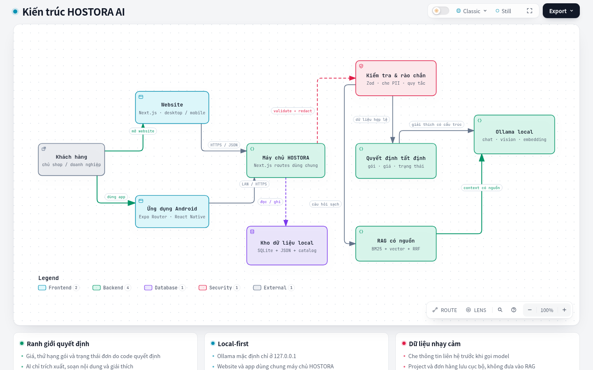

# HOSTORA AI

HOSTORA AI là hệ thống bán dịch vụ website dành cho chủ shop và doanh nghiệp Việt Nam không rành kỹ thuật. Khách có thể khám phá dịch vụ, nhờ AI làm rõ nhu cầu, tạo thử một website, nhận gợi ý gói lưu trữ, gửi yêu cầu mua, thanh toán và theo dõi đơn ngay trên website hoặc ứng dụng HOSTORA. Người vận hành xử lý cùng dữ liệu đó tại trang quản trị.

AI của HOSTORA chạy cục bộ qua Ollama. AI chỉ đọc, giải thích và soạn nội dung; giá, xếp hạng gói, voucher, trạng thái đơn và kết quả thanh toán vẫn do mã nguồn tất định kiểm soát. Dữ liệu thiếu phải được ghi là “Chưa có dữ liệu” hoặc “Chưa xác minh”, không được để mô hình tự điền.

> Trạng thái ngày 28/10/2026: luồng sản phẩm, đơn hàng, email, thanh toán thử nghiệm, RAG và Website Studio đã có mã nguồn và kiểm thử tự động. Stripe/VNPay thật, đồng bộ GitHub cho website khách, gửi email bằng tên miền riêng và triển khai Internet vẫn cần tài khoản/cấu hình của HOSTORA trước khi vận hành thật.

## HOSTORA bán gì?

Danh mục hiện có 26 sản phẩm từ 6 nhà cung cấp, gồm:

- hosting dùng chung, WordPress, cloud, VPS và hosting cho website bán hàng;
- tên miền, SSL, email doanh nghiệp và bộ công cụ làm việc;
- công cụ tạo website và tự động hóa;
- dịch vụ của HOSTORA hoặc sản phẩm đối tác do HOSTORA tiếp nhận yêu cầu, xác nhận giá và phát hành hóa đơn.

Khách không bị đưa sang website khác để xem sản phẩm. Toàn bộ hành trình khám phá, tư vấn, gửi yêu cầu, xem hóa đơn và theo dõi trạng thái nằm trong HOSTORA. Khi dùng cổng thanh toán thật, Stripe hoặc VNPay sẽ mở trang nhập thông tin bảo mật của chính cổng, sau đó đưa khách trở lại HOSTORA.

## Ba bề mặt, một hệ thống

| Bề mặt           | Vai trò                                                                          | Dữ liệu dùng chung                               |
| ---------------- | -------------------------------------------------------------------------------- | ------------------------------------------------ |
| Website Next.js  | Trang giới thiệu nhanh, catalog, tư vấn AI, Website Studio, đơn hàng và tải app  | API AI, catalog, dự án Studio và SQLite đơn hàng |
| Ứng dụng Android | Trải nghiệm ưu tiên điện thoại, tư vấn, xem sản phẩm, tạo website và tra cứu đơn | Gọi cùng API HOSTORA qua LAN/HTTPS               |
| Trang quản trị   | Xử lý yêu cầu mua, báo giá, hóa đơn, thanh toán, hủy và hoàn tiền                | Cùng SQLite đơn hàng với website/app             |

Yêu cầu mua và hóa đơn được lưu trong `data/runtime/payments.sqlite`, vì vậy website, app và `/admin/orders` nhìn thấy cùng một trạng thái. Riêng wizard tư vấn, lịch sử chat và danh sách lead cũ vẫn nằm trong trình duyệt bằng `localStorage`; phần này chưa phải hệ thống quản lý khách hàng nhiều nhân viên.



Các sơ đồ tương tác do Archify tạo và đã qua kiểm tra trình duyệt:

- [Kiến trúc tổng thể](docs/architecture/hostora-system.html)
- [Luồng sản phẩm và đơn hàng](docs/architecture/hostora-product-flow.html)
- [Luồng RAG local](docs/architecture/hostora-rag-flow.html)
- [Luồng AI Website Studio](docs/architecture/hostora-site-studio-flow.html)

## Luồng sản phẩm và mua hàng

### 1. Khám phá và làm rõ nhu cầu

Khách xem nhanh dịch vụ trên website/app hoặc mô tả bằng lời. HOSTORA hỏi các thông tin có ảnh hưởng thật đến lựa chọn: loại website, khách hàng mục tiêu, lượng truy cập dự kiến, ngân sách, tình trạng website, tên miền, email, backup và mục tiêu tìm kiếm.

Nếu khách chưa có website, chatbot không ép mua hosting. Nó hướng khách tới **Xưởng tạo website**, đợi khách tạo bản xem trước rồi dùng mục tiêu/chức năng của website đó để tư vấn tiếp.

### 2. So sánh và gợi ý gói

`lib/recommendation.ts`, `lib/pricing.ts` và `lib/scenario.ts` tính điểm, tổng chi phí và kịch bản bằng mã nguồn. AI chỉ giải thích kết quả theo tiếng Việt dễ hiểu. Luồng chuẩn trả một lựa chọn chính và tối đa hai lựa chọn thay thế, đồng thời nêu:

- giá kỳ đầu, kỳ hạn và giá gia hạn nếu đã được xác minh;
- lý do phù hợp với nhu cầu;
- giới hạn, chi phí còn thiếu hoặc điều cần thử tải;
- nguồn và ngày đối chiếu dữ liệu.

HOSTORA không cam kết chịu tải chỉ từ “lượt truy cập mỗi tháng”, không tự xác nhận tên miền còn trống và không suy đoán giá gia hạn khi catalog để `null`.

### 3. Gửi yêu cầu mua

Khách điền email, thông tin doanh nghiệp, sản phẩm/dịch vụ chính, khu vực phục vụ, mục tiêu website/SEO, lượng khách, ngân sách và cách tư vấn mong muốn. Khách có thể:

- chọn thời điểm tư vấn qua email, điện thoại hoặc video;
- chọn AI tư vấn trước;
- nhập voucher nếu có;
- hủy yêu cầu bằng mã riêng.

Hệ thống kiểm tra giới hạn mọi trường bằng Zod, tạo mã `HSR-*`, lưu vào SQLite và gửi email xác nhận cho khách nếu SMTP đã sẵn sàng.

### 4. Quản trị chốt giá và tạo hóa đơn

Tại `/admin/orders`, quản trị viên đăng nhập bằng mã một lần gửi qua email quản trị hoặc mật khẩu dự phòng. Màn hình có tìm kiếm, bộ lọc trạng thái, cổng thanh toán, loại dịch vụ, khoảng ngày, sắp xếp và phân trang; không cần kéo qua hàng nghìn đơn.

Quản trị viên kiểm tra nhà cung cấp, kỳ hạn, thuế, điều kiện và tổng tiền rồi tạo hóa đơn `HST-*`. Khách nhận email chứa mã đơn và liên kết tra cứu riêng. Giá trong hóa đơn được lấy từ SQLite; AI không có quyền sửa.

### 5. Thanh toán và bảo chứng trạng thái

Khách mở `/orders` hoặc màn **Đơn hàng** trong app, nhập mã đơn và mã truy cập, rồi chọn Stripe hoặc VNPay.

- Stripe chỉ ghi nhận đã trả khi webhook/đối soát khớp mã hóa đơn, số tiền, tiền tệ và PaymentIntent.
- VNPay chỉ ghi nhận đã trả khi IPN hoặc kết quả đối soát có chữ ký HMAC hợp lệ, đúng mã đơn và đúng số tiền.
- Trang quay về sau thanh toán không tự đánh dấu thành công.
- Callback lặp được xử lý theo hướng idempotent, không phát voucher hay ghi tiền hai lần.
- Chế độ `demo` chỉ phục vụ kiểm thử nội bộ và không thu tiền; chế độ `sandbox` cần khóa thử nghiệm riêng của HOSTORA.

Sau khi cổng xác nhận đơn từ 1.000.000đ, hệ thống phát voucher 100.000đ cho đơn tiếp theo từ 1.000.000đ, có hiệu lực 30 ngày và chỉ dùng một lần.

### 6. Email, hủy và hoàn tiền

Hệ thống gửi email cho khách khi nhận yêu cầu, phát hành hóa đơn và khi trạng thái thanh toán/hủy/hoàn tiền thay đổi. Email có bản HTML, bản văn bản thuần, mã tham chiếu, nút xem đơn và hướng dẫn bảo vệ mã truy cập. Để thư không vào Spam, tên miền gửi phải có SPF, DKIM và DMARC; giao diện email đẹp không thay thế xác thực DNS.

Khách có thể hủy hóa đơn chưa thanh toán hoặc gửi yêu cầu hoàn sau khi đã trả. Quản trị viên duyệt/từ chối tại `/admin/orders`. Stripe/VNPay chỉ chuyển đơn sang **Đã hoàn tiền** sau khi phản hồi cổng được kiểm chứng; timeout giữ trạng thái chờ đối soát để tránh hoàn hai lần. Dịch vụ số không có luồng vận chuyển/trả hàng vật lý.

## Luồng AI tư vấn

`POST /api/ai/chat` xử lý theo thứ tự sau:

1. Kiểm tra JSON, số lượng tin nhắn và chiều dài bằng Zod.
2. Che email/số điện thoại trước khi truy xuất hoặc gọi mô hình; yêu cầu gửi PII vào model bị từ chối.
3. Các trường hợp nhạy cảm được xử lý trước bằng quy tắc tất định: chưa có website, chưa đủ dữ kiện chọn gói, giá gia hạn chưa rõ, tên miền, DNS, structured data, thanh toán chưa cập nhật, email chưa tới và hoàn tiền.
4. Nếu cần kiến thức, hệ thống truy xuất RAG và chọn tối đa 7 tài liệu cùng các mục catalog liên quan.
5. Ollama local tạo câu trả lời với context 16K; không có cloud fallback.
6. Citation được hậu kiểm, citation không nằm trong context bị loại bỏ; log chỉ ghi model, độ trễ, token và số nguồn, không ghi nội dung chat hay PII.
7. Giao diện nhận câu trả lời tiếng Việt và hành động tiếp theo như mở Xưởng tạo website hoặc tải ảnh màn hình cho OCR.

OCR hành trình dùng `qwen3-vl:8b` local để đọc ảnh, xác định khách đang ở màn nào và hướng dẫn bước tiếp theo. Ảnh được giới hạn kích thước/định dạng, không lưu vào lịch sử chat; người dùng vẫn phải che số thẻ, CVC, OTP và mã truy cập.

## Luồng RAG local

Nguồn kiến thức nằm tại `data/knowledge.json`; index embedding được tạo ở `data/rag-index.json`. Hiện kho có 36 tài liệu. Quy trình:

```text
Câu hỏi
  → mở rộng từ khóa theo chủ đề
  → BM25 trên tiêu đề, từ khóa và nội dung
  → embedding bằng qwen3-embedding:4b
  → cosine similarity
  → Reciprocal Rank Fusion (65% semantic, 35% lexical)
  → đa dạng hóa URL/chủ đề
  → context có citation, URL và ngày xác minh
  → Ollama trả lời
  → lọc citation không hợp lệ
```

Nếu Ollama embedding chưa chạy hoặc index không khớp model/nội dung hiện tại, retriever chuyển sang BM25 thay vì giả vờ đã tìm bằng vector. Nội dung RAG được xem là dữ liệu không tin cậy: mọi chỉ dẫn nằm trong tài liệu đều bị bỏ qua. Giá và tình trạng thương mại không được fine-tune vào trọng số; chúng luôn lấy từ catalog có nguồn.

Tạo/làm mới và đánh giá index:

```bash
pnpm rag:index
pnpm rag:evaluate
pnpm rag:evaluate:live
```

`rag:evaluate` đo retrieval trên bộ câu hỏi nội bộ. Recall/MRR không chứng minh mọi câu trả lời trung thực; backlog đánh giá còn faithfulness, answer relevance, prompt injection và đánh giá bởi người dùng thật.

## Luồng AI tạo website

Website Studio nhận mô tả doanh nghiệp, khách hàng mục tiêu, hành động chính, phong cách, màu nhấn, mức truy cập và ngân sách. Luồng đang phục vụ được điều phối bằng LangGraph:

1. API kiểm tra brief bằng schema và giới hạn đầu vào.
2. Email/số điện thoại bị che trước khi gửi vào model.
3. `STUDIO_MODEL` chỉ sinh JSON nội dung: headline, subheadline, CTA, phần giới thiệu, ba điểm nổi bật và SEO title/description.
4. Bộ kiểm tra từ khóa loại các tuyên bố không có trong brief.
5. Một lần gọi AI độc lập kiểm chứng toàn bộ nội dung; nếu model lỗi hoặc bản nháp bịa dữ kiện, Studio dùng nội dung mẫu an toàn.
6. Gợi ý hosting được tính tất định từ catalog, không để AI tự chọn giá hoặc gói.
7. Renderer do HOSTORA kiểm soát tạo HTML/CSS/JS, responsive mobile/desktop, Three.js, GSAP, focus state và `prefers-reduced-motion`.
8. Dự án được lưu cục bộ, trả link xem tương tác, link tải ZIP và khung chat sửa tiếp.
9. Nếu `HOSTORA_STUDIO_GITHUB_ENABLED=true` và máy chủ đã `gh auth login`, hệ thống tạo repo GitHub riêng tư cho khách và tự commit/push sau mỗi lần sửa. Nếu GitHub lỗi, link HOSTORA và ZIP vẫn hoạt động.

AI không được sinh rồi thực thi mã HTML/JS tùy ý trong luồng production. Bộ dữ liệu Studio có cả kế hoạch thiết kế có cấu trúc (bố cục, mật độ, kiểu chữ, vai trò màu nhấn, mức chuyển động và motif 3D), nhưng renderer vẫn là ranh giới an toàn cuối cùng.

## Fine-tuning và vòng học từ phản hồi

Chatbot và Studio được train riêng bằng LoRA trên `unsloth/Qwen3.5-4B`; feedback không tự ghi thẳng vào trọng số đang phục vụ. Quy trình đúng là thu thập phản hồi đã ẩn danh → phân loại lỗi → duyệt dữ liệu → tạo train/holdout tách biệt → train → reload adapter → đánh giá → chỉ promote khi đạt ngưỡng.

### Kết quả đã xác minh

| Ứng viên                   | Dữ liệu/huấn luyện                                                 | Đánh giá giữ lại                                                                                                                      | Trạng thái                                                              |
| -------------------------- | ------------------------------------------------------------------ | ------------------------------------------------------------------------------------------------------------------------------------- | ----------------------------------------------------------------------- |
| `hostora-chatbot:4b-q8-v5` | 543 mẫu train, 6 epoch, 1.086 bước, loss 0,3769, VRAM đỉnh 9,72 GB | 124/124 HTTP/schema; 124/124 tiếng Việt phổ thông; 124/124 không bịa số thương mại; 119/124 định tuyến đúng; 62/124 có bước tiếp theo | **Candidate only**, không tự promote                                    |
| `hostora-studio:4b-q8-v2`  | 928 mẫu train, 5 epoch, 1.160 bước, loss 0,0753, VRAM đỉnh 9,62 GB | 192/192 HTTP/schema cho design plan và code-package holdout                                                                           | **Candidate only**, renderer production vẫn không chạy mã model tự sinh |

`chatbot-v5` reload adapter và export GGUF Q8 thành công, nhưng còn 5 lỗi định tuyến; bộ đo ban đầu chỉ nhận ra 50% câu có bước tiếp theo. Vì vậy runtime không được tự đổi sang v5 chỉ dựa vào loss. Artifact model/GGUF khoảng 4,6 GB bị Git ignore; GitHub chứa cấu hình, script, manifest dữ liệu và tài liệu để tái lập, không chứa checkpoint nặng.

Đợt `chatbot-v6` bổ sung tình huống tư vấn và đang được chạy như một ứng viên
riêng; xem `pnpm ai:train:chatbot:status`. Bộ đo v5 cũ đã đếm thiếu các câu
như “cần kiểm tra” và “nên thử”: chấm lại cùng câu trả lời là 121/124 có bước
tiếp theo, còn 119/124 định tuyến đúng. V6 chỉ được đánh giá sau khi train
xong và không tự thay model đang phục vụ.

Xem [bằng chứng fine-tuning](docs/CHATBOT_FINETUNING.md), [rubric AI và chuyển đổi](docs/AI_EVALUATION.md) và `training/README.md`.

## Langfuse và đo chuyển đổi

Langfuse là tùy chọn và mặc định tắt. Chỉ bật khi đã có project riêng và kiểm chứng trace end-to-end. HOSTORA chỉ gửi metadata như tính năng, chế độ tạo, độ trễ, đánh giá hữu ích/cần sửa, lý do feedback và bước phễu ẩn danh; không gửi prompt, nội dung website, email, số điện thoại hoặc mã đơn.

Bốn nhóm đánh giá ưu tiên:

1. đúng dữ liệu giá và nguồn;
2. an toàn, không bịa;
3. hữu ích với nhu cầu thật;
4. chuyển đổi từ xem demo → mở gói → gửi yêu cầu → bắt đầu thanh toán.

Fine-tuning không thay thế A/B test, phỏng vấn khách, kiểm tra conversion thật và review thủ công.

## Bảo mật và quyền riêng tư

- Ollama mặc định chỉ ở `127.0.0.1`; không có cloud fallback.
- API AI kiểm tra schema, giới hạn dữ liệu và không cấp shell/filesystem/network tool cho model.
- Website Analyzer chặn SSRF trước khi tải HTML công khai.
- Giá, khuyến mại, voucher và trạng thái đơn không nằm trong quyền quyết định của LLM.
- Mã truy cập đơn được băm trong SQLite; trang quản trị có phiên đăng nhập, kiểm tra same-origin và giới hạn input.
- Stripe webhook và VNPay IPN được kiểm chữ ký/số tiền trước khi đổi trạng thái.
- `.env*`, SQLite runtime, raw lead, trace PII, checkpoint và APK build không được commit.
- Che PII trong văn bản tự do là best-effort, không phải bảo đảm tuyệt đối.

Trước khi mở ra Internet cần thêm reverse proxy HTTPS, rate limit, backup mã hóa, giám sát, chính sách lưu dữ liệu, tài khoản người dùng/phân quyền và kiểm thử xâm nhập trên môi trường được phép.

## Cài và chạy local

Yêu cầu Node.js 22+, pnpm và Ollama. Dùng model cục bộ, không cần khóa AI cloud.

```bash
git clone https://github.com/minhnhatdepzai/HOSTORA-AI.git
cd HOSTORA-AI
git checkout v2.0.9-review-20261029-r2
cp .env.example .env.local
pnpm install
ollama pull qwen3.5:9b-q8_0
ollama pull qwen3-embedding:4b
ollama pull qwen3-vl:8b
pnpm rag:index
pnpm ai:check
pnpm dev
```

Mở <http://127.0.0.1:3000>. Nếu điện thoại cùng Wi-Fi cần truy cập máy HOSTORA, chạy `pnpm dev:lan`, cấu hình server trong app bằng `http://<IP-máy-HOSTORA>:3000` và chỉ dùng trên mạng tin cậy.

Muốn kiểm tra bản production local: chạy `pnpm build` rồi `pnpm start`. Lệnh build chép JavaScript/CSS, ảnh và tối đa hai APK hiện có vào bản standalone, đồng thời loại dữ liệu đơn hàng và dự án khách khỏi thư mục build. Khi chép bản standalone sang máy khác, cấu hình `.env.local`/biến môi trường và dữ liệu vận hành riêng trên máy đó.

### Chạy bằng Docker

```bash
./scripts/docker-up.sh
```

Máy có NVIDIA Container Toolkit dùng `./scripts/docker-up.sh --gpu`. Lần đầu cần tải model và sẽ tốn thời gian/dung lượng. Xem [hướng dẫn Docker](docs/DOCKER_DEPLOYMENT.md).

## Android

- Bản arm64 local hiện tại: `mobile/releases/HOSTORA-AI-2.0.9-arm64.apk` (đã cài và mở trên Redmi Note 8 Pro).
- Bản universal local: `mobile/releases/HOSTORA-AI-2.0.3-universal.apk`.
- Khi web đang chạy: `/downloads/android` và `/downloads/android-universal`.
- Bản đánh giá công khai: [HOSTORA 2.0.9 prerelease cập nhật](https://github.com/minhnhatdepzai/HOSTORA-AI/releases/tag/v2.0.9-review-20261029-r2). Bản ổn định cũ: [v1.5.0](https://github.com/minhnhatdepzai/HOSTORA-AI/releases/tag/v1.5.0).

APK build không được commit vào source vì kích thước lớn. Xem [hướng dẫn mobile](mobile/README.md), [audit giao diện](docs/MOBILE_UI_AUDIT.md) và `mobile/releases/SHA256SUMS.txt` trước khi phát hành.

Bản nguồn chuẩn bị đánh giá nằm tại `docs/submission/HOSTORA-source-2.0.9-2026-10-29.zip`. ZIP này gồm RAG index của bộ tài liệu công khai và cấu hình cài dependency cho web/app; loại dữ liệu đơn hàng cục bộ, khóa bí mật, model weights và APK. Người đánh giá cần cài dependency và cấu hình Ollama theo hướng dẫn trong README; chạy `pnpm rag:index` khi đổi nguồn tri thức hoặc model embedding. Bản đối chiếu kết quả mới nằm ở [JUDGE_HANDOFF_2026-10-29.md](docs/submission/JUDGE_HANDOFF_2026-10-29.md).

## Cấu hình tùy chọn

Các biến mẫu nằm trong `.env.example`:

- `OLLAMA_*`: chat, chatbot, Studio, vision, embedding, context và timeout;
- `HOSTORA_PAYMENTS_*`, `HOSTORA_STRIPE_*`, `HOSTORA_VNPAY_*`: SQLite và cổng thanh toán;
- `HOSTORA_SMTP_*`, `HOSTORA_EMAIL_*`: email khách/quản trị;
- `HOSTORA_ADMIN_*`: phiên quản trị và mật khẩu dự phòng;
- `HOSTORA_STUDIO_GITHUB_*`: repo riêng cho website khách;
- `LANGFUSE_*`: quan sát AI và phễu ẩn danh.

Không sao chép khóa của JAPANO hoặc dự án khác. HOSTORA phải dùng tài khoản merchant, email và GitHub credential riêng.

## Kiểm tra trước khi bàn giao

```bash
pnpm typecheck
pnpm lint
pnpm test
pnpm build
pnpm test:e2e
pnpm ai:check
```

`pnpm ai:check` gọi inference local thật; unit test hoặc HTTP 200 không thay thế nó. Playwright cần chạy cả desktop và mobile. Giá catalog có ngày xác minh riêng trong `docs/DATA_SOURCES.md` và phải được đối chiếu lại trước khi phát hành hóa đơn.

## Cấu trúc chính

```text
app/                         Website, admin và API Next.js
app/api/ai/                  Chat, OCR, RAG, phân tích và Website Studio
app/api/payments/            Yêu cầu mua, hóa đơn, checkout và callback
app/api/admin/payments/      Đăng nhập, lọc đơn, báo giá, hoàn/đối soát
components/                  Giao diện web và trang quản trị
mobile/                      Ứng dụng React Native / Expo Router
data/hosting-catalog.ts      13 gói hosting có nguồn
data/product-catalog.ts      26 sản phẩm/dịch vụ
data/knowledge.json          36 tài liệu RAG có nguồn/ngày xác minh
data/rag-index.json          Embedding index local
lib/recommendation.ts        Chấm điểm gói tất định
lib/pricing.ts               Tính chi phí tất định
lib/rag.ts                   BM25, vector, RRF và fallback
lib/site-studio-workflow.ts  LangGraph cho nội dung Studio
lib/site-studio.ts           Renderer HTML/Three.js/GSAP được kiểm soát
lib/payments/                Đơn hàng, email, Stripe và VNPay
training/                    Dữ liệu, cấu hình, train/export/eval LoRA
docs/architecture/           Sơ đồ Archify tương tác
```

## Tài liệu chi tiết

- [Kiến trúc AI](docs/AI_ARCHITECTURE.md)
- [Nguồn dữ liệu và ngày xác minh](docs/DATA_SOURCES.md)
- [Thiết lập Stripe/VNPay và email](docs/PAYMENTS_SETUP.md)
- [Fine-tuning chatbot](docs/CHATBOT_FINETUNING.md)
- [Đánh giá AI và phễu chuyển đổi](docs/AI_EVALUATION.md)
- [Báo cáo bảo mật](docs/SECURITY_REVIEW.md)
- [Báo cáo QA](docs/QA_REPORT.md)
- [Kịch bản demo](docs/DEMO_SCRIPT.md)
- [Thiết lập môi trường](docs/ENVIRONMENT_SETUP.md)
- [Đối chiếu tiêu chí và bằng chứng](docs/JUDGING_READINESS.md)

## Giới hạn trung thực

- Chưa có tài khoản merchant HOSTORA nên chưa có bằng chứng giao dịch/hoàn tiền thật từ Stripe hoặc VNPay.
- Chưa có URL triển khai công khai ổn định; link LAN không phải link production.
- Repo GitHub riêng cho khách chỉ hoạt động khi máy chủ đã kết nối GitHub và bật cấu hình.
- SMTP hoạt động không bảo đảm vào Inbox nếu tên miền chưa có SPF/DKIM/DMARC và uy tín gửi.
- `chatbot-v5` và `studio-v2` là ứng viên, chưa được tự động promote.
- 124/124 hoặc 192/192 schema hợp lệ không chứng minh câu trả lời đúng, website đẹp hay tăng doanh thu.
- Trang quản trị lead cũ vẫn dùng dữ liệu trình duyệt; chỉ đơn hàng/hóa đơn dùng SQLite chung.
- Giá, ưu đãi và tình trạng tên miền thay đổi theo thời gian; phải xác minh trước khi bán.
- Năng lực chịu tải chỉ được kết luận sau benchmark workload thật trên máy triển khai.

HOSTORA ưu tiên bằng chứng: phần đã có mã, đã test, đang là candidate và chưa sẵn sàng production phải luôn được ghi tách biệt.
