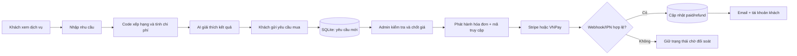
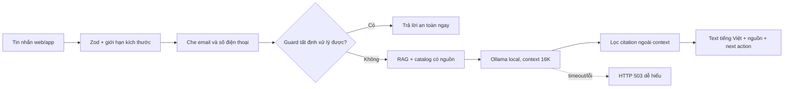
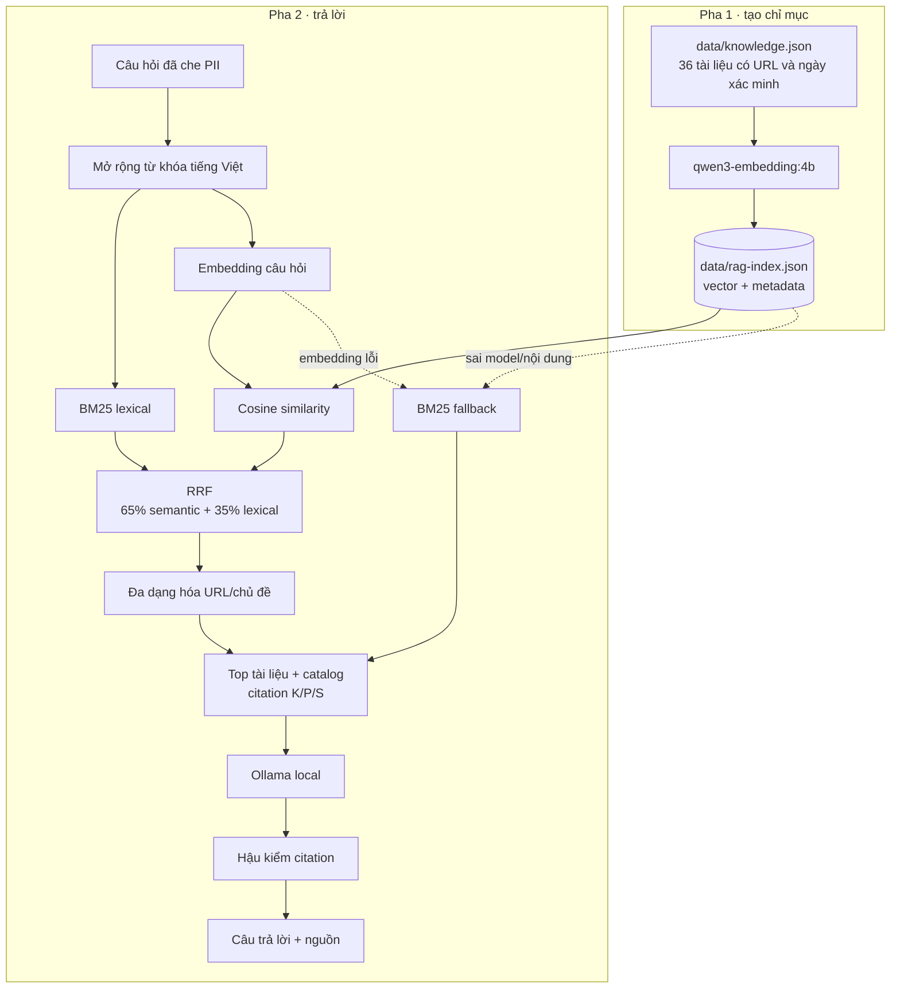
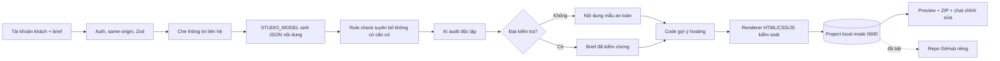

# HOSTORA AI

HOSTORA AI là nền tảng local-first giúp chủ shop và doanh nghiệp Việt Nam đi từ một nhu cầu còn mơ hồ đến website, hạ tầng và đơn hàng có thể theo dõi. Khách khám phá dịch vụ, nhờ AI làm rõ nhu cầu, tạo website mẫu, so sánh hosting, gửi yêu cầu mua và quản lý tài khoản trên web hoặc Android. Người vận hành dùng web admin để quản lý catalog, hỗ trợ, báo giá, hóa đơn, thanh toán và doanh thu trên cùng dữ liệu.

AI của HOSTORA chạy cục bộ qua Ollama. AI chỉ đọc, giải thích và soạn nội dung; giá, xếp hạng gói, voucher, trạng thái đơn và kết quả thanh toán vẫn do mã nguồn tất định kiểm soát. Dữ liệu thiếu phải được ghi là “Chưa có dữ liệu” hoặc “Chưa xác minh”, không được để mô hình tự điền.

> Trạng thái ngày 29/10/2026: source web, admin và Android 2.1.0 đã qua typecheck, lint, build production, 198 unit test, 47 E2E desktop/mobile và AI smoke test local. APK 2.1.0 (versionCode 22) đã được cài đè và mở trên Redmi Note 8 Pro. Đây là bằng chứng local; Stripe/VNPay thật, SMTP tên miền, URL production ổn định và nghiên cứu người dùng vẫn chưa được xác nhận.

| Phần đã kiểm tra | Kết quả gần nhất                                                                                       |
| ---------------- | ------------------------------------------------------------------------------------------------------ |
| Web + admin      | Build production thành công; 47 E2E pass, 1 ca mobile chủ động skip                                    |
| Logic và API     | 198/198 unit test pass trên 48 file                                                                    |
| AI local         | Ollama chat, chatbot, Studio và embedding trả inference thật; không dùng cloud fallback                |
| Android          | `com.hostora.ai` 2.1.0, versionCode 22; cài bằng `adb install -r`, giữ dữ liệu app                     |
| Giới hạn còn mở  | Contrast/ARIA, độ ổn định timeout AI, endpoint public, payment/SMTP production và test người dùng thật |

## HOSTORA bán gì?

Danh mục hiện có 29 sản phẩm từ 9 nhà cung cấp và 13 gói hosting được chấm điểm riêng, gồm:

- hosting dùng chung, WordPress, cloud, VPS và hosting cho website bán hàng;
- tên miền, SSL, email doanh nghiệp và bộ công cụ làm việc;
- công cụ tạo website và tự động hóa;
- dịch vụ của HOSTORA hoặc sản phẩm đối tác do HOSTORA tiếp nhận yêu cầu, xác nhận giá và phát hành hóa đơn.

Khách không bị đưa sang website khác để xem sản phẩm. Toàn bộ hành trình khám phá, tư vấn, gửi yêu cầu, xem hóa đơn và theo dõi trạng thái nằm trong HOSTORA. Khi dùng cổng thanh toán thật, Stripe hoặc VNPay sẽ mở trang nhập thông tin bảo mật của chính cổng, sau đó đưa khách trở lại HOSTORA.

## Ba bề mặt, một hệ thống

| Bề mặt           | Vai trò                                                                     | Dữ liệu dùng chung                               |
| ---------------- | --------------------------------------------------------------------------- | ------------------------------------------------ |
| Website Next.js  | Catalog, tài khoản, tư vấn AI, Studio, sổ tay, yêu cầu mua và tra cứu đơn   | API AI, catalog, project và SQLite local         |
| Ứng dụng Android | Tư vấn bốn bước, trợ lý, sản phẩm, Studio, tài khoản, thông báo và đơn hàng | Gọi cùng API HOSTORA qua LAN/HTTPS               |
| Web quản trị     | Catalog, hỗ trợ, doanh thu, yêu cầu mua, hóa đơn, thanh toán và hoàn tiền   | Cùng store catalog, tài khoản và SQLite đơn hàng |

Yêu cầu mua và hóa đơn được lưu trong `data/runtime/payments.sqlite`, vì vậy website, app và `/admin/orders` nhìn thấy cùng một trạng thái. Riêng wizard tư vấn, lịch sử chat và danh sách lead cũ vẫn nằm trong trình duyệt bằng `localStorage`; phần này chưa phải hệ thống quản lý khách hàng nhiều nhân viên.


Các sơ đồ tương tác được sinh từ source tại commit `1eb26b9` và đã qua kiểm tra schema, liên kết mã nguồn, layout và trình duyệt:

- [Kiến trúc tổng thể](docs/architecture/hostora-system.html)
- [Luồng sản phẩm và đơn hàng](docs/architecture/hostora-product-flow.html)
- [Luồng RAG local](docs/architecture/hostora-rag-flow.html)
- [Luồng AI Website Studio](docs/architecture/hostora-site-studio-flow.html)

Kiến trúc hoạt động theo nguyên tắc **ba giao diện, một backend**. Mọi input đi qua xác thực/schema trước khi tới logic domain hoặc AI. Giá, xếp hạng và trạng thái giao dịch do TypeScript/SQLite quyết định; RAG và Ollama chỉ cung cấp ngữ cảnh, nội dung và lời giải thích. Stripe, VNPay, SMTP và GitHub là nhánh tùy chọn, không phải điều kiện để chạy local.

## Luồng sản phẩm và mua hàng



Luồng này tách rõ ba quyền quyết định: khách mô tả nhu cầu, code chọn phương án theo dữ liệu, còn quản trị viên chốt điều kiện thương mại. Cổng thanh toán chỉ đổi trạng thái sau khi bằng chứng giao dịch khớp; trang quay về không đủ quyền đánh dấu đã trả.

### 1. Khám phá và làm rõ nhu cầu

Khách xem nhanh dịch vụ trên website/app hoặc mô tả bằng lời. HOSTORA hỏi các thông tin có ảnh hưởng thật đến lựa chọn: loại website, khách hàng mục tiêu, lượng truy cập dự kiến, ngân sách, tình trạng website, tên miền, email, backup và mục tiêu tìm kiếm.

Nếu khách chưa có website, chatbot không ép mua hosting. Nó hướng khách tới **Xưởng tạo website**, đợi khách tạo bản xem trước rồi dùng mục tiêu/chức năng của website đó để tư vấn tiếp.

### 2. So sánh và gợi ý gói

`lib/recommendation.ts`, `lib/pricing.ts` và `lib/scenario.ts` tính điểm, tổng chi phí và kịch bản bằng mã nguồn. AI chỉ giải thích kết quả theo tiếng Việt dễ hiểu. Luồng chuẩn trả một lựa chọn chính và tối đa hai lựa chọn thay thế, đồng thời nêu:

- giá kỳ đầu, kỳ hạn và giá gia hạn nếu đã được xác minh;
- lý do phù hợp với nhu cầu;
- giới hạn, chi phí còn thiếu hoặc điều cần thử tải;
- nguồn và ngày đối chiếu dữ liệu.

HOSTORA không cam kết chịu tải chỉ từ “lượt truy cập mỗi tháng”, không tự xác nhận tên miền còn trống và không suy đoán giá gia hạn khi catalog để `null`.

### 3. Gửi yêu cầu mua

Khách điền email, thông tin doanh nghiệp, sản phẩm/dịch vụ chính, khu vực phục vụ, mục tiêu website/SEO, lượng khách, ngân sách và cách tư vấn mong muốn. Khách có thể:

- chọn thời điểm tư vấn qua email, điện thoại hoặc video;
- chọn AI tư vấn trước;
- nhập voucher nếu có;
- hủy yêu cầu bằng mã riêng.

Hệ thống kiểm tra giới hạn mọi trường bằng Zod, tạo mã `HSR-*`, lưu vào SQLite và gửi email xác nhận cho khách nếu SMTP đã sẵn sàng.

### 4. Quản trị chốt giá và tạo hóa đơn

Tại `/admin/orders`, quản trị viên đăng nhập bằng mã một lần gửi qua email quản trị hoặc mật khẩu dự phòng. Màn hình có tìm kiếm, bộ lọc trạng thái, cổng thanh toán, loại dịch vụ, khoảng ngày, sắp xếp và phân trang; không cần kéo qua hàng nghìn đơn.

Quản trị viên kiểm tra nhà cung cấp, kỳ hạn, thuế, điều kiện và tổng tiền rồi tạo hóa đơn `HST-*`. Khách nhận email chứa mã đơn và liên kết tra cứu riêng. Giá trong hóa đơn được lấy từ SQLite; AI không có quyền sửa.

### 5. Thanh toán và bảo chứng trạng thái

Khách mở `/orders` hoặc màn **Đơn hàng** trong app, nhập mã đơn và mã truy cập, rồi chọn Stripe hoặc VNPay.

- Stripe chỉ ghi nhận đã trả khi webhook/đối soát khớp mã hóa đơn, số tiền, tiền tệ và PaymentIntent.
- VNPay chỉ ghi nhận đã trả khi IPN hoặc kết quả đối soát có chữ ký HMAC hợp lệ, đúng mã đơn và đúng số tiền.
- Trang quay về sau thanh toán không tự đánh dấu thành công.
- Callback lặp được xử lý theo hướng idempotent, không phát voucher hay ghi tiền hai lần.
- Chế độ `demo` chỉ phục vụ kiểm thử nội bộ và không thu tiền; chế độ `sandbox` cần khóa thử nghiệm riêng của HOSTORA.

Sau khi cổng xác nhận đơn từ 1.000.000đ, hệ thống phát voucher 100.000đ cho đơn tiếp theo từ 1.000.000đ, có hiệu lực 30 ngày và chỉ dùng một lần.

### 6. Email, hủy và hoàn tiền

Hệ thống gửi email cho khách khi nhận yêu cầu, phát hành hóa đơn và khi trạng thái thanh toán/hủy/hoàn tiền thay đổi. Email có bản HTML, bản văn bản thuần, mã tham chiếu, nút xem đơn và hướng dẫn bảo vệ mã truy cập. Để thư không vào Spam, tên miền gửi phải có SPF, DKIM và DMARC; giao diện email đẹp không thay thế xác thực DNS.

Khách có thể hủy hóa đơn chưa thanh toán hoặc gửi yêu cầu hoàn sau khi đã trả. Quản trị viên duyệt/từ chối tại `/admin/orders`. Stripe/VNPay chỉ chuyển đơn sang **Đã hoàn tiền** sau khi phản hồi cổng được kiểm chứng; timeout giữ trạng thái chờ đối soát để tránh hoàn hai lần. Dịch vụ số không có luồng vận chuyển/trả hàng vật lý.

## Luồng AI tư vấn

`POST /api/ai/chat` xử lý theo thứ tự sau:



1. Kiểm tra JSON, số lượng tin nhắn và chiều dài bằng Zod.
2. Che email/số điện thoại trước khi truy xuất hoặc gọi mô hình; yêu cầu gửi PII vào model bị từ chối.
3. Các trường hợp nhạy cảm được xử lý trước bằng quy tắc tất định: chưa có website, chưa đủ dữ kiện chọn gói, giá gia hạn chưa rõ, tên miền, DNS, structured data, thanh toán chưa cập nhật, email chưa tới và hoàn tiền.
4. Nếu cần kiến thức, hệ thống truy xuất RAG và chọn tối đa 7 tài liệu cùng các mục catalog liên quan.
5. Ollama local tạo câu trả lời với context 16K; không có cloud fallback.
6. Citation được hậu kiểm, citation không nằm trong context bị loại bỏ; log chỉ ghi model, độ trễ, token và số nguồn, không ghi nội dung chat hay PII.
7. Giao diện nhận câu trả lời tiếng Việt và hành động tiếp theo như mở Xưởng tạo website hoặc tải ảnh màn hình cho OCR.

OCR hành trình dùng `qwen3-vl:8b` local để đọc ảnh, xác định khách đang ở màn nào và hướng dẫn bước tiếp theo. Ảnh được giới hạn kích thước/định dạng, không lưu vào lịch sử chat; người dùng vẫn phải che số thẻ, CVC, OTP và mã truy cập.

## Luồng RAG local

Nguồn kiến thức nằm tại `data/knowledge.json`; index embedding được tạo ở `data/rag-index.json`. Hiện kho có 36 tài liệu. RAG gồm một pha lập chỉ mục và một pha truy xuất lúc khách hỏi:



Pha lập chỉ mục gọi embedding theo lô và ghi vector cạnh metadata của từng tài liệu. Khi khách hỏi, HOSTORA chạy BM25 và vector song song, hợp nhất thứ hạng bằng RRF, rồi giảm việc nhiều kết quả trùng URL/chủ đề. Top tài liệu, gói hosting và sản phẩm được gắn citation trước khi đưa vào model. Sau khi model trả lời, citation không nằm trong context bị loại bỏ.

Nếu Ollama embedding chưa chạy hoặc index không khớp model/nội dung hiện tại, retriever chuyển sang BM25 và báo mode `lexical-fallback` thay vì giả vờ đã tìm bằng vector. Nội dung RAG được xem là dữ liệu không tin cậy: mọi chỉ dẫn nằm trong tài liệu đều bị bỏ qua. Giá và tình trạng thương mại không được fine-tune vào trọng số; chúng luôn lấy từ catalog có nguồn.

Tạo/làm mới và đánh giá index:

```bash
pnpm rag:index
pnpm rag:evaluate
pnpm rag:evaluate:live
```

`rag:evaluate` đo retrieval trên bộ câu hỏi nội bộ. Recall/MRR không chứng minh mọi câu trả lời trung thực; backlog đánh giá còn faithfulness, answer relevance, prompt injection và đánh giá bởi người dùng thật.

## Luồng AI tạo website

Website Studio nhận mô tả doanh nghiệp, khách hàng mục tiêu, hành động chính, phong cách, màu nhấn, mức truy cập và ngân sách. Luồng đang phục vụ được điều phối bằng LangGraph:



Model không được giao quyền sinh rồi thực thi mã. Nó chỉ soạn JSON nội dung; rule check và một lượt audit riêng loại tuyên bố ngoài brief. Khi AI lỗi hoặc bản nháp không đạt, luồng vẫn hoàn tất bằng template an toàn. Renderer thuộc HOSTORA chịu trách nhiệm về responsive, chuyển động, Three.js, accessibility và file ZIP.

1. API kiểm tra brief bằng schema và giới hạn đầu vào.
2. Email/số điện thoại bị che trước khi gửi vào model.
3. `STUDIO_MODEL` chỉ sinh JSON nội dung: headline, subheadline, CTA, phần giới thiệu, ba điểm nổi bật và SEO title/description.
4. Bộ kiểm tra từ khóa loại các tuyên bố không có trong brief.
5. Một lần gọi AI độc lập kiểm chứng toàn bộ nội dung; nếu model lỗi hoặc bản nháp bịa dữ kiện, Studio dùng nội dung mẫu an toàn.
6. Gợi ý hosting được tính tất định từ catalog, không để AI tự chọn giá hoặc gói.
7. Renderer do HOSTORA kiểm soát tạo HTML/CSS/JS, responsive mobile/desktop, Three.js, GSAP, focus state và `prefers-reduced-motion`.
8. Dự án được lưu cục bộ, trả link xem tương tác, link tải ZIP và khung chat sửa tiếp.
9. Nếu `HOSTORA_STUDIO_GITHUB_ENABLED=true` và máy chủ đã `gh auth login`, hệ thống tạo repo GitHub riêng tư cho khách và tự commit/push sau mỗi lần sửa. Nếu GitHub lỗi, link HOSTORA và ZIP vẫn hoạt động.

AI không được sinh rồi thực thi mã HTML/JS tùy ý trong luồng production. Bộ dữ liệu Studio có cả kế hoạch thiết kế có cấu trúc (bố cục, mật độ, kiểu chữ, vai trò màu nhấn, mức chuyển động và motif 3D), nhưng renderer vẫn là ranh giới an toàn cuối cùng.

## Fine-tuning và vòng học từ phản hồi

Chatbot và Studio được train riêng bằng LoRA trên `unsloth/Qwen3.5-4B`; feedback không tự ghi thẳng vào trọng số đang phục vụ. Quy trình đúng là thu thập phản hồi đã ẩn danh → phân loại lỗi → duyệt dữ liệu → tạo train/holdout tách biệt → train → reload adapter → đánh giá → chỉ promote khi đạt ngưỡng.

### Kết quả đã xác minh

| Ứng viên                   | Dữ liệu                                         | Kết quả holdout local                                                                                  | Quyết định                                                   |
| -------------------------- | ----------------------------------------------- | ------------------------------------------------------------------------------------------------------ | ------------------------------------------------------------ |
| `hostora-chatbot:4b-q8-v6` | 655 train, 142 holdout                          | 142/142 HTTP, schema, ngôn ngữ phổ thông, không bịa số và có bước tiếp theo; 134/142 định tuyến đúng   | Đủ điều kiện review thủ công, **candidate only**             |
| `hostora-chatbot:4b-q8-v7` | 671 train, 146 holdout, có hội thoại nhiều lượt | 146/146 HTTP/schema; 145/146 ngôn ngữ và bước tiếp theo; 132/146 định tuyến đúng                       | Kém v6 trên cùng tập v7 ở định tuyến; giữ **candidate only** |
| `hostora-studio:4b-q8-v3`  | 384 train, 24 holdout                           | 24/24 schema, không bịa số, không hype chung, bám thương hiệu, tách section và đủ chiều sâu theo bộ đo | Đủ điều kiện review thủ công, **candidate only**             |

Các số trên là đánh giá tự động cục bộ, không phải chấm mù bởi khách hàng hay chuyên gia độc lập. Runtime hiện vẫn dùng model được cấu hình trong `.env.local`; train/eval không tự promote. Artifact adapter, checkpoint và GGUF 4–5 GB bị Git ignore. GitHub chỉ chứa dataset, config, script, Modelfile và tài liệu để tái lập.

Xem [bằng chứng fine-tuning](docs/CHATBOT_FINETUNING.md), [rubric AI và chuyển đổi](docs/AI_EVALUATION.md) và `training/README.md`.

## Langfuse và đo chuyển đổi

Langfuse là tùy chọn và mặc định tắt. Chỉ bật khi đã có project riêng và kiểm chứng trace end-to-end. HOSTORA chỉ gửi metadata như tính năng, chế độ tạo, độ trễ, đánh giá hữu ích/cần sửa, lý do feedback và bước phễu ẩn danh; không gửi prompt, nội dung website, email, số điện thoại hoặc mã đơn.

Bốn nhóm đánh giá ưu tiên:

1. đúng dữ liệu giá và nguồn;
2. an toàn, không bịa;
3. hữu ích với nhu cầu thật;
4. chuyển đổi từ xem demo → mở gói → gửi yêu cầu → bắt đầu thanh toán.

Fine-tuning không thay thế A/B test, phỏng vấn khách, kiểm tra conversion thật và review thủ công.

## Bảo mật và quyền riêng tư

- Ollama mặc định chỉ ở `127.0.0.1`; không có cloud fallback.
- API AI kiểm tra schema, giới hạn dữ liệu và không cấp shell/filesystem/network tool cho model.
- Website Analyzer chặn SSRF trước khi tải HTML công khai.
- Giá, khuyến mại, voucher và trạng thái đơn không nằm trong quyền quyết định của LLM.
- Mã truy cập đơn được băm trong SQLite; trang quản trị có phiên đăng nhập, kiểm tra same-origin và giới hạn input.
- Stripe webhook và VNPay IPN được kiểm chữ ký/số tiền trước khi đổi trạng thái.
- `.env*`, SQLite runtime, raw lead, trace PII, checkpoint và APK build không được commit.
- Che PII trong văn bản tự do là best-effort, không phải bảo đảm tuyệt đối.

Trước khi mở ra Internet cần thêm reverse proxy HTTPS, rate limit, backup mã hóa, giám sát, chính sách lưu dữ liệu, tài khoản người dùng/phân quyền và kiểm thử xâm nhập trên môi trường được phép.

## Cài và chạy local

Yêu cầu Node.js 22+, pnpm và Ollama. Dùng model cục bộ, không cần khóa AI cloud.

```bash
git clone https://github.com/minhnhatdepzai/HOSTORA-AI.git
cd HOSTORA-AI
cp .env.example .env.local
pnpm install
ollama pull qwen3.5:9b-q8_0
ollama pull qwen3-embedding:4b
ollama pull qwen3-vl:8b
pnpm rag:index
pnpm ai:check
pnpm dev
```

Mở <http://127.0.0.1:3000>. Nếu điện thoại cùng Wi-Fi cần truy cập máy HOSTORA, chạy `pnpm dev:lan`, cấu hình server trong app bằng `http://<IP-máy-HOSTORA>:3000` và chỉ dùng trên mạng tin cậy.

Muốn kiểm tra bản production local: chạy `pnpm build` rồi `pnpm start`. Lệnh build chép JavaScript/CSS, ảnh và tối đa hai APK hiện có vào bản standalone, đồng thời loại dữ liệu đơn hàng và dự án khách khỏi thư mục build. Khi chép bản standalone sang máy khác, cấu hình `.env.local`/biến môi trường và dữ liệu vận hành riêng trên máy đó.

### Chạy bằng Docker

```bash
./scripts/docker-up.sh
```

Máy có NVIDIA Container Toolkit dùng `./scripts/docker-up.sh --gpu`. Lần đầu cần tải model và sẽ tốn thời gian/dung lượng. Xem [hướng dẫn Docker](docs/DOCKER_DEPLOYMENT.md).

## Android

- Bản arm64 local hiện tại: `mobile/releases/HOSTORA-AI-2.1.0-arm64.apk` (versionCode 22, đã cài và mở ổn định trên Redmi Note 8 Pro; checksum nằm cạnh APK).
- Intro app 2.1.0: video cục bộ 7 giây, H → HOSTORA → mascot; có nút bỏ qua và tự chuyển về Trang chủ sau khi kết thúc.
- Bản universal local: `mobile/releases/HOSTORA-AI-2.0.3-universal.apk`.
- Khi web đang chạy: `/downloads/android` và `/downloads/android-universal`.
- Source trên `main` là 2.1.0. APK public gần nhất vẫn là [HOSTORA 2.0.9 prerelease](https://github.com/minhnhatdepzai/HOSTORA-AI/releases/tag/v2.0.9-review-20261029-r2); cần tạo release 2.1.0 riêng trước khi nói bản APK mới đã được phân phối công khai.

APK build không được commit vào source vì kích thước lớn. Xem [hướng dẫn mobile](mobile/README.md), [audit giao diện](docs/MOBILE_UI_AUDIT.md) và `mobile/releases/SHA256SUMS.txt` trước khi phát hành.

Bản đối chiếu tiêu chí, test và giới hạn bàn giao nằm ở [JUDGE_HANDOFF_2026-10-29.md](docs/submission/JUDGE_HANDOFF_2026-10-29.md). ZIP, APK, model weights, dữ liệu runtime và secret không nằm trong source Git; hãy dùng script đóng gói/release để tạo artifact từ commit cần bàn giao.

## Cấu hình tùy chọn

Các biến mẫu nằm trong `.env.example`:

- `OLLAMA_*`: chat, chatbot, Studio, vision, embedding, context và timeout;
- `HOSTORA_PAYMENTS_*`, `HOSTORA_STRIPE_*`, `HOSTORA_VNPAY_*`: SQLite và cổng thanh toán;
- `HOSTORA_SMTP_*`, `HOSTORA_EMAIL_*`: email khách/quản trị;
- `HOSTORA_ADMIN_*`: phiên quản trị và mật khẩu dự phòng;
- `HOSTORA_STUDIO_GITHUB_*`: repo riêng cho website khách;
- `LANGFUSE_*`: quan sát AI và phễu ẩn danh.

Không sao chép khóa của JAPANO hoặc dự án khác. HOSTORA phải dùng tài khoản merchant, email và GitHub credential riêng.

## Kiểm tra trước khi bàn giao

```bash
pnpm agent:doctor
pnpm agent:verify
pnpm test:e2e:isolated
pnpm audit:ui
pnpm test:mobile:mcp
```

`agent:verify` chạy typecheck/lint/test/build cho web, typecheck/lint cho app và `ai:check` bằng inference local thật. `test:e2e:isolated` dùng SQLite/session riêng; `audit:ui` chụp desktop/mobile và chạy axe; `test:mobile:mcp` đi luồng native trên điện thoại thật. HTTP 200, browser viewport hoặc APK build thành công không thay thế việc kiểm tra nội dung AI và luồng Android.

## Cấu trúc chính

```text
app/                         Website, admin và API Next.js
app/api/ai/                  Chat, OCR, RAG, phân tích và Website Studio
app/api/payments/            Yêu cầu mua, hóa đơn, checkout và callback
app/api/admin/payments/      Đăng nhập, lọc đơn, báo giá, hoàn/đối soát
components/                  Giao diện web và trang quản trị
mobile/                      Ứng dụng React Native / Expo Router
data/hosting-catalog.ts      13 gói hosting có nguồn
data/product-catalog.ts      29 sản phẩm/dịch vụ
data/knowledge.json          36 tài liệu RAG có nguồn/ngày xác minh
data/rag-index.json          Embedding index local
lib/recommendation.ts        Chấm điểm gói tất định
lib/pricing.ts               Tính chi phí tất định
lib/rag.ts                   BM25, vector, RRF và fallback
lib/site-studio-workflow.ts  LangGraph cho nội dung Studio
lib/site-studio.ts           Renderer HTML/Three.js/GSAP được kiểm soát
lib/payments/                Đơn hàng, email, Stripe và VNPay
training/                    Dữ liệu, cấu hình, train/export/eval LoRA
docs/architecture/           Sơ đồ Archify tương tác
```

## Tài liệu chi tiết

- [Kiến trúc AI](docs/AI_ARCHITECTURE.md)
- [Nguồn dữ liệu và ngày xác minh](docs/DATA_SOURCES.md)
- [Thiết lập Stripe/VNPay và email](docs/PAYMENTS_SETUP.md)
- [Fine-tuning chatbot](docs/CHATBOT_FINETUNING.md)
- [Đánh giá AI và phễu chuyển đổi](docs/AI_EVALUATION.md)
- [Báo cáo bảo mật](docs/SECURITY_REVIEW.md)
- [Báo cáo QA](docs/QA_REPORT.md)
- [Kịch bản demo](docs/DEMO_SCRIPT.md)
- [Thiết lập môi trường](docs/ENVIRONMENT_SETUP.md)
- [Đối chiếu tiêu chí và bằng chứng](docs/JUDGING_READINESS.md)
- [SEO/GEO, llms.txt và nguồn tham khảo](docs/SEO_GEO_SOURCES.md)

## SEO và GEO

- `/robots.txt` cho phép Google và nhóm bot tìm kiếm AI đọc các trang công khai, đồng thời chặn `/admin`, `/api` và `/orders`.
- `/sitemap.xml` liệt kê các trang bán hàng, tư vấn và sổ tay với thời điểm cập nhật hiện tại.
- `/llms.txt` là bản tóm tắt chính thức cho trợ lý AI; `/llms-full.txt` có danh mục và sổ tay chi tiết, kèm ngày xác minh.
- Trang chủ xuất JSON-LD cho `Organization`, `WebSite`, `SoftwareApplication`, `WebApplication` và `FAQPage`; manifest có shortcut cho tư vấn và Website Studio.
- Website Analyzer kiểm tra thêm llms.txt và ngữ cảnh thực thể thương hiệu khi audit GEO.
- Cloudflare có thể chèn robots riêng ở phía trước ứng dụng. Nếu muốn chatbot tìm kiếm trích dẫn HOSTORA, phải cho phép AI search bots trong AI Crawl Control của Cloudflare; kiểm tra lại `/robots.txt` public sau khi bật.

## Giới hạn trung thực

- Chưa có tài khoản merchant HOSTORA nên chưa có bằng chứng giao dịch/hoàn tiền thật từ Stripe hoặc VNPay.
- Chưa có URL triển khai công khai ổn định; link LAN không phải link production.
- Repo GitHub riêng cho khách chỉ hoạt động khi máy chủ đã kết nối GitHub và bật cấu hình.
- SMTP hoạt động không bảo đảm vào Inbox nếu tên miền chưa có SPF/DKIM/DMARC và uy tín gửi.
- `chatbot-v6`, `chatbot-v7` và `studio-v3` là ứng viên local, chưa được tự động promote.
- Schema/HTTP pass không chứng minh câu trả lời đúng nguồn, website đẹp hay tăng doanh thu.
- Trang quản trị lead cũ vẫn dùng dữ liệu trình duyệt; chỉ đơn hàng/hóa đơn dùng SQLite chung.
- Giá, ưu đãi và tình trạng tên miền thay đổi theo thời gian; phải xác minh trước khi bán.
- Năng lực chịu tải chỉ được kết luận sau benchmark workload thật trên máy triển khai.

HOSTORA ưu tiên bằng chứng: phần đã có mã, đã test, đang là candidate và chưa sẵn sàng production phải luôn được ghi tách biệt.

## URL public qua Cloudflare

Khi cần cho giám khảo hoặc khách thử web ngoài mạng LAN, HOSTORA có lệnh mở Cloudflare Quick Tunnel:

```bash
pnpm tunnel:cloudflare
```

Lệnh kiểm tra `/api/health` rồi chuyển cổng web local 3000 thành URL HTTPS `https://*.trycloudflare.com`. Giữ cửa sổ lệnh chạy trong suốt thời gian demo; URL sẽ đổi sau khi tunnel dừng. Dừng bằng:

```bash
pnpm tunnel:cloudflare:stop
```

Quick Tunnel phù hợp cho đánh giá tạm thời, không phải địa chỉ production cố định. Muốn URL cố định cần tạo tunnel có tên trong Cloudflare, trỏ DNS của tên miền HOSTORA vào tunnel và đặt `HOSTORA_PUBLIC_BASE_URL` cùng các URL callback thanh toán theo tên miền HTTPS đó. Không đưa token Cloudflare vào Git hoặc `.env.example`.
