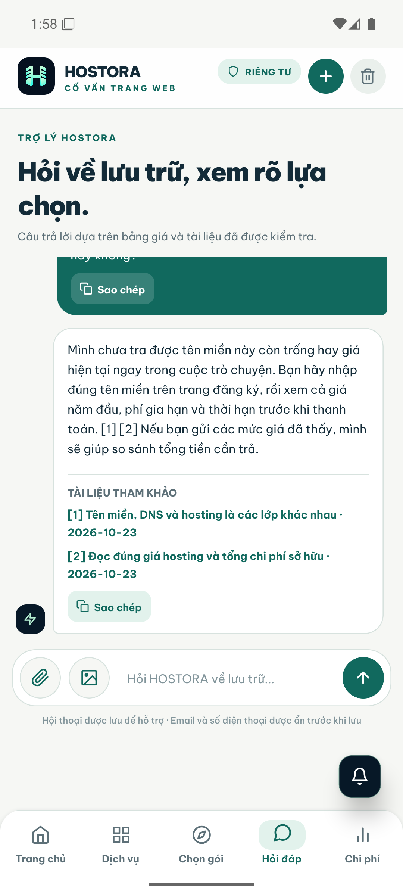

# Nghiệm thu chatbot và tư vấn HOSTORA 2.2.4 — 05/11/2026

## Cách khách nhìn thấy nguồn

Câu trả lời chỉ hiển thị số tham chiếu `[1]`, `[2]` theo thứ tự xuất hiện. Ngay bên dưới là **Tài liệu tham khảo** với tiêu đề, ngày kiểm tra và liên kết HTTPS nếu nguồn có URL. Mã nội bộ như `[K1]` và `[P2]` vẫn được giữ trong dữ liệu hội thoại để truy vết, nhưng không hiện với khách.

## Các ca đã đi thực tế

| Ca | Kết quả quan sát | Trạng thái |
| --- | --- | --- |
| WooCommerce 15.000 lượt/tháng, flash sale 300 người, ngân sách 300.000đ | Đưa gói chính và hai phương án so sánh; nêu tiền trả trước, giá gia hạn, cần thử tải đúng 300 người và hỏi khả năng trả trước | Trợ lý tiếp tục |
| Đã bật CDN nhưng 200 khách cùng đặt hàng vẫn chậm | Giải thích giới hạn CDN, hướng đo giỏ hàng/thanh toán và chỉ cân nhắc nâng hosting sau khi có số đo | Trợ lý tiếp tục |
| Chuyển hosting, giữ email, SEO và đơn hàng | Nêu sao lưu/thử trước, thiết lập email, đồng bộ đơn hàng, URL/canonical/sitemap và câu hỏi còn thiếu | Trợ lý tiếp tục |
| Tên miền còn trống và giá hiện tại | Không bịa dữ liệu thời gian thực; chỉ khách kiểm tra giá năm đầu, phí gia hạn và điều kiện | Trợ lý tiếp tục |
| Bài tích phân ngoài phạm vi | Không giải toán; chuyển quản trị viên trong server kiểm thử cách ly, SMTP tắt | Chuyển quản trị viên |
| Bot quét khi mở bán làm rớt đơn | Ưu tiên đối chiếu bot với lỗi đặt hàng và đo tải thanh toán; không lạc sang sitemap/SEO | Trợ lý tiếp tục |
| Hai khách dùng chung một gói hosting | Nêu điều kiện số website được phép theo gói, rủi ro tranh tài nguyên, chỗ lưu video và phép thử cao điểm; không khẳng định bắt buộc tách gói | Trợ lý tiếp tục |

Ba ca CDN, chuyển hosting và tên miền được gõ gửi trực tiếp trong APK x86_64 `2.2.4` trên Android Emulator 16 (`emulator-5554`) vào backend production cổng 3200. Bản cài đè bằng `adb install -r` giữ lịch sử chat cũ. Ảnh trên là bằng chứng native của cách hiển thị số nguồn và danh sách tài liệu.

## Gate và giới hạn

- `pnpm agent:verify`: 326/326 unit/API test, typecheck/lint/build web và mobile, AI smoke Ollama thật đạt.
- `pnpm test:e2e:isolated`: 57 ca browser desktop/mobile đạt, 1 ca được đánh dấu bỏ qua; SQLite và SMTP kiểm thử tách biệt production.
- `pnpm audit:ui`: 12 trang desktop/mobile, không có lỗi accessibility tự động hoặc lỗi trang.
- `pnpm test:mobile:e2e`: chưa đạt vì Maestro driver trên emulator gặp `UiAutomationService already registered`, sau đó `DeviceServerDiedException` trước bước đầu luồng. Đây là lỗi công cụ kiểm thử; các thao tác chat native ở trên được thực hiện bằng Mobile MCP và có ảnh bằng chứng.
- Các ca trên kiểm tra đường đi và chất lượng của vài câu khó. Chúng không chứng minh mọi câu hỏi tương lai đều chính xác hay mọi nguồn được model dùng đúng ngữ nghĩa.

LangGraph hiện dùng cho **Website Studio**. Chatbot dùng bảo vệ đầu vào, bộ nhớ nhu cầu, RAG/citation, catalog tất định và Ollama; chưa có graph LangGraph cho chat. Thêm LangGraph chỉ nên làm khi có nhu cầu điều phối nhiều bước đo được, không xem đó là điều kiện để lời tư vấn tự nhiên hơn.
